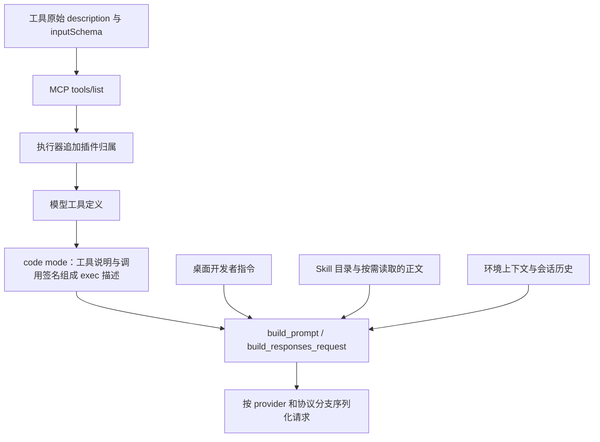

# Codex 模型提示词与工具描述的拼接逻辑

核查对象：本机 Codex Desktop `26.1023.51421`，随包执行器 `0.165.0-alpha.1.2`。核查日期：2026-10-30。

本次从 Electron 包代码和 Rust 执行器 ARM64 反汇编追踪拼接逻辑，并与用户指定的 15:35 桌面会话记录对照。没有修改 Moss 运行代码或 Codex 配置。下面的伪代码是等价逻辑说明，不是声称恢复了完整 Rust 源码或抓到了线上请求体。

## 结论

Codex 分别处理工具定义、开发者指令、Skill 目录、环境和会话历史。工具描述的核心流程是：**工具提供方给出功能描述和参数 schema → 执行器追加插件归属 → 转为模型工具定义；启用 code mode 时，再生成工具调用签名并组织进 `functions.exec` 的说明。**

`This tool is part of plugin ...` 确实是 Codex 执行器的拼接逻辑。Moss 当前描述不准确的原因，应当与“是否保留插件归属”分开判断。



## 1. 原始工具定义来自提供方，功能文案没有由请求构建器重写

在 `app.asar` 的 `webview/assets/app-initial-bc8256c3cccb.js` 找到真实定义，变量名为 `A7a`，初始化函数为 `j7a`。其等价摘录是：

```js
{
  name: "load_workspace_dependencies",
  description:
    "Locate the configured bundled workspace dependency runtime paths for this local desktop thread, including Node.js, Python, and useful libraries for working with spreadsheets, slide decks, Word documents, and PDFs. This is read-only and takes no arguments.",
  inputSchema: {
    type: "object",
    properties: {},
    additionalProperties: false
  }
}
```

原文描述已经说明了目的、返回的资源范围、只读性质和无参数要求，此时没有插件来源后缀。

证据：[原始定义的格式化摘录](../output/codex-prompt-analysis-20261030/workspace-tool-original.js)、[ASAR 哈希及字节位置](../output/codex-prompt-analysis-20261030/app-initial-tool-snippets.json)。摘录前逐字节核对了 ASAR 条目声明的 SHA-256。

桌面 `main-UOTY8NmV.js` 的 `Que`（第 15397 行）转换宿主工具时直接取：

```js
{
  description: tool.description,
  inputSchema: tool.inputSchema,
  name: tool.name,
  namespace: namespace.name
}
```

安装的 `codex-app-tools/0.1.6/server.mjs` 在 `tools/list` 中读取这些定义，返回 MCP 工具时去掉内部 `namespace` 字段。其 `initialize` 说明为 `Tools provided by the Codex app.`；这里没有添加 `This tool is part of plugin ...`。

## 2. 插件归属在 Rust 执行器的 MCP 准备阶段追加

找到两个保留了真实符号名的入口：

- `codex_mcp::rmcp_client::prepare_regular_mcp_tools_for_model`，地址 `0x1079107b4`。
- `codex_mcp::rmcp_client::prepare_codex_apps_tools_for_model`，地址 `0x107910114`。

两者直接调用同一个内部拼接函数 `0x10790f094`。对 ARM64 `BL` 指令的直接调用目标解码确认了这一点，普通 MCP 分支的调用点为 `0x1079108cc` / `0x1079108f4`，Apps 分支为 `0x107910524`。

该函数通过 `ADRP/ADD` 引用二进制中的格式字符串 `This tool is part of plugin`，再将插件名称放进反引号。对于一个插件、通常长度的名称，逻辑可还原为：

```js
// 单一插件的正常路径；省略多个插件和长度限制分支。
function appendPluginOrigin(originalDescription, pluginNames) {
  if (pluginNames.length === 0) return originalDescription;

  const suffix = "This tool is part of plugin `" + pluginNames[0] + "`.";
  const description = trim(originalDescription ?? "");
  if (!description) return suffix;

  const separator = /[.!?]$/.test(description) ? " " : ". ";
  return description + separator + suffix;
}
```

终止标点判断也在代码中：位掩码 `0x8000400200000000` 对应 ASCII `!`、`.`、`?`。源码还处理多个归属插件、归属句长度限制和 `, and N more.` 的情况，不是对每个工具硬编码相同的插件名。

证据：[普通 MCP 准备函数](../output/codex-prompt-analysis-20261030/prepare-regular-mcp.asm)、[归属拼接函数](../output/codex-prompt-analysis-20261030/plugin-suffix.asm)、[直接调用证据](../output/codex-prompt-analysis-20261030/native-direct-calls.json)、[字符串引用地址](../output/codex-prompt-analysis-20261030/native-literal-xrefs.json)。

因此，真实会话里这个工具的完整描述会以如下内容结尾：

```text
... This is read-only and takes no arguments. This tool is part of plugin `codex-app-tools`.
```

## 3. code mode 把工具说明和参数签名组成 exec 的描述

执行器中的实际符号包括：

| 函数 | 地址 | 对应步骤 |
| --- | --- | --- |
| `codex_tools::code_mode::code_mode_tool_definitions_for_spec` | `0x1092b5c5c` | 从工具 spec 构建 code mode 定义 |
| `codex_tools::code_mode::augment_tool_spec_for_code_mode` | `0x1092b4e74` | 为工具定义补充 code mode 所需信息 |
| `codex_code_mode_protocol::description::render_code_mode_sample` | `0x10448a210` | 拼接调用签名和说明 |
| `codex_code_mode_protocol::description::build_exec_tool_description` | `0x10448a3cc` | 组织 exec 主说明、共享类型及工具说明 |

二进制中可直接读到这些格式模板，且反汇编有对应的字符串引用：

````text
## {namespace}
{namespaceDescription}

### `{toolName}`
{description}

exec tool declaration:
```ts
declare const tools: { {toolName}(args: {inputType}): Promise<{outputType}>; };
```
````

工具名称会做 JavaScript 标识符规范化；输入 schema 和输出类型用于生成 TypeScript 调用签名。exec 自身还包含执行规则、可用辅助函数、共享 MCP 类型，以及延迟工具发现的说明。并非所有延迟工具都必须一次写入 exec 的说明。

用户指定的真实会话记录中，第 3 行的 `additional_tools` 定义包含 `functions.exec`；其 `description` 内实际出现：

```ts
declare const tools: {
  mcp__codex_app__load_workspace_dependencies(args: {}): Promise<CallToolResult>;
};
```

该签名与原始 `inputSchema` 的空对象一致。第 56 行的 `ALL_TOOLS` 查询返回了相同的描述和签名，第 84 行模型实际执行了 `tools.mcp__codex_app__load_workspace_dependencies({})`。

证据：[exec 描述构建函数](../output/codex-prompt-analysis-20261030/exec-description.asm)、[调用签名拼接函数](../output/codex-prompt-analysis-20261030/exec-sample.asm)、[真实会话工具定义](../output/codex-prompt-analysis-20261030/latest-session-tools-context.json)。

## 4. 开发者指令、Skill、环境各有独立的拼接入口

桌面 `AEe`（`main-UOTY8NmV.js:47642`）分别处理 `baseInstructions`、`developerInstructions`、`dynamicTools` 和配置。桌面 MCP 模式下，宿主工具通过 MCP 注册，`dynamicTools` 参数使用空数组，并配置启用的工具名称。

`getProjectAwareDeveloperInstructions`（同文件第 99914 行）将已有指令、用户自定义指令、适用的工作树偏好等传给上下文构建器。`src-tOjGKoT3.js` 中：

- `hx`（第 18759 行）对片段 `trim`、去掉空项，以两个换行连接。
- `fx`（第 18717 行附近）依据功能开关加入桌面说明、依赖定位说明、任务工具说明等。
- `bx`（第 18786 行附近）将桌面上下文包在 `<app-context>` 中，再连接到已有开发者指令。
- `AEe` 最后还会按条件追加写作块说明和 `additionalDeveloperInstructions`。

Skill 目录由执行器的 `codex_skills_extension::extension::render_catalog` 构建；环境由 `RenderedEnvironments` 的 `ContextualUserFragment::body` 构建。环境不是在某个工具的 description 中拼出来的。

与最新实际会话对照：

| 内容 | 实际记录的承载位置 | 拼接行为 |
| --- | --- | --- |
| 桌面说明和 Skill 目录 | developer message | Skill 名称、适用场景、根目录映射、文件路径 |
| Skill 正文 | 读取文件后的工具结果 | 模型按需读取 `SKILL.md`，正文进入后续上下文 |
| 环境 | user message 的 `<environment_context>` | cwd、shell、日期、时区、workspace roots、权限 |
| 工具定义 | developer 角色的 `additional_tools` 记录 | 本会话采用 code mode 包装 |
| 用户请求和历史工具结果 | 各自的会话项 | 保持各自角色和调用关联 |

这里的“实际记录位置”描述 rollout；它不等于声称线上 HTTP 请求具有完全相同的外层字段。

## 5. 最后由请求构建器完成协议序列化

找到 `codex_core::session::turn::build_prompt`（`0x104f1585c`）和 `<codex_core::client::ModelClient>::build_responses_request`（`0x104e95d40`）。多处调用路径先调用前者，再调用后者；已保存 ARM64 直接调用证据。

请求构建函数中可以确认：

- 普通 Responses 分支在 `0x104e960c8` 调用 `create_tools_raw_json_for_responses_api`。
- Responses Lite 分支在 `0x104e96054` 调用 `create_tools_json_for_responses_lite`。
- 同一函数还处理消息内容元数据、推理档位、文本响应配置、service tier 等模型请求信息。
- provider、模型能力及协议开关会影响请求组织方式，不能把单次隔离测试的外层 JSON 当作所有配置的通用格式。

可以用以下概念伪代码概括，省略协议分支及内部类型：

```js
const toolSpecs = prepareModelTools(providerTools, pluginOwnership, features);
const context = buildContext({
  baseInstructions,
  developerInstructions,
  skillCatalog,
  environment,
  conversationHistory
});
const prompt = build_prompt(context, toolSpecs);
const request = build_responses_request(prompt, model, provider, features);
```

工具功能文字在进入这个阶段之前已经确定。这个阶段没有将“导出表格文件”改写成“获取此 App 的导出作品信息”的逻辑。

## 对 Moss 当前问题的含义

1. 模型需要准确的工具用途、输入、输出和副作用。Moss 的“获取此 App 的导出作品信息”与实际打开目录选择器、写出文件不符，问题在原始功能描述。
2. 让模型知道插件来源有 Codex 代码依据；是否保留及采用什么措辞，可以独立设计，不能直接认定这类信息应当删除。
3. Codex 原版表格能力使用 Skill 与 `@oai/artifact-tool`。当前核查链路里没有独立的 `spreadsheet_export`；不能把 Moss 的适配接口描述当成原版 Codex 工具文案。
4. 环境是独立上下文，应与插件归属、Skill 路径区分。最新真实会话的插件路径出现在 Skill 目录，依赖路径由定位工具返回；环境里展示工作区和可视化输出目录。

## 证据范围

Electron 部分使用已核验哈希的 ASAR 代码，前期有 REA 静态分析记录。本轮原生部分使用系统 LLVM 静态反汇编：真实符号名、Mach-O `LC_FUNCTION_STARTS` 函数边界、直接分支目标及原始字符串相互核对。未附加运行进程，也未修改可执行文件。

LLVM 对无符号地址显示的“最近符号 + 偏移”不视为该地址的真实函数名。例如归属拼接例程以确切入口 `0x10790f094` 标注；其调用者有真实符号名。自动提取的字符串候选不等于完整数据流，报告只使用已手工对应的关键位置。

实际原生二进制 SHA-256：`d84a54b031085f01e3ad915ea7c72ebea4dcf69e90f0d1e0e4a637e8280991d2`。[二进制身份](../output/codex-prompt-analysis-20261030/native-binary-identity.json)、[函数证据清单](../output/codex-prompt-analysis-20261030/native-function-evidence.json)、[静态提取脚本](../output/codex-prompt-analysis-20261030/inspect_native_assembly.py)。
