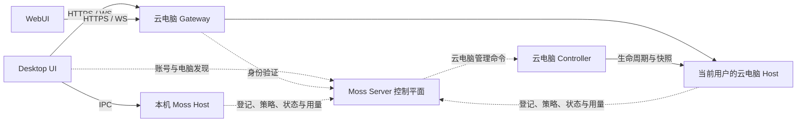

# Moss 控制平面与工作电脑改造方案

日期：2026-11-02。状态：规划，尚未实施。

目标：退役 Moss Server 托管执行会话，Desktop 支持本地电脑和当前用户的云电脑，WebUI 固定操作所在云电脑。Server 承担企业控制平面，Agent、工具、终端和定时任务由工作电脑上的 Moss Host 执行。

本文中的 WebUI 是浏览器界面；实际执行者是云电脑上的 Host。个人云电脑可以继续使用现有持久 Docker 容器，无须为了这次职责调整更换为 VM。

## 1. 产品行为

| 入口 | 工作电脑 | 会话、项目和文件 | 切换行为 |
| --- | --- | --- | --- |
| Desktop | 此电脑、我的云电脑 | 属于选中的 Host | 切换完整工作上下文；已有会话仍属于原 Host |
| WebUI | 当前登录用户的云电脑 | 属于该云电脑 Host | 隐藏模式选择，仅显示电脑名称和连接状态 |
| 企业管理后台 | 管理已登记的 Desktop 和云电脑 | 展示设备、策略、任务状态及用量元数据 | 下发控制指令，由目标 Host 执行 |

建议把选择器放在工作区顶部，名称用“此电脑 / 我的云电脑”。不要继续在每次新建聊天时选择两种 Agent 运行方式。未开通云电脑时显示开通状态；电脑离线时明确提示，不自动切到本地或新建替代电脑。

首期每个组织中的用户对应一台默认云电脑，Desktop 可登记多台本地设备。Desktop 和浏览器登录相同账号，必须进入同一台云电脑，看到同一组会话、项目、文件和任务。

企业账号连接与工作电脑选择分开。用户选择此电脑，不应退出企业账号，也不应停用云存储、企业策略或协作邮箱。WebUI 不提供再连接另一台 Moss Server 执行 Agent 的入口。

## 2. 当前代码基础

| 现有实现 | 本次处理 |
| --- | --- |
| `cloud/store.mjs`、`cloud/environments.mjs` | 已按 `(orgId, userId)` 保存个人环境及真实容器 ID；复用归属、持久化、升级与恢复机制 |
| `cloud/gateway.mjs` | 已有认证、个人 Host 路由和环境管理；扩展 Desktop 接入与受控管理接口 |
| `ui/src/web/server.mjs`、`ui/src/host/request-registry.mjs` | 已有 Host HTTP/WS 服务和共享处理器；作为云端完整业务接口 |
| `ui/src/client/moss-client.mjs`、`electron-transport.mjs`、`web-transport.mjs` | 已有共享客户端及两种传输；补充 Desktop 访问云 Host 的适配 |
| `ui/src/remote-direct-client.mjs`、`remote-session-runtime.mjs`、`main.mjs` 中相关分支 | 旧 Server 会话链路；在新 Host 链路验收后退役 |
| `server/src/runtimeService.ts`、`backends/`、`sessionRunner*` | 旧会话执行、容器与进程管理；从 Server 正常运行链路移除 |
| `admin/src/pages/sessions-page.tsx`、`session-detail-page.tsx` | 退役服务端执行会话管理；调整为电脑管理、控制任务和审计入口 |

目前服务端不仅创建会话，还将认证以外的多个服务绑定到 `runtime.store.db`。因此不能直接删除 RuntimeService：要先让这些服务直接依赖数据库和各自 Repository。

`packages/direct-connect-protocol` 中还包含本地执行使用的设置类型，`src/electron-direct.ts` 和多个设置服务仍在引用。删除远程协议前先提取共享设置 schema；不要按名称整包删除，也不要误删 Desktop 的本地执行入口。

## 3. 目标架构与职责

Gateway 和 Controller 目前同处 `cloud/`，首期可保持同一部署。职责先拆清，进程拆分放到需要独立扩缩容或权限隔离时再做。

| 组件 | 保留或新增职责 | 退出的职责 |
| --- | --- | --- |
| Server | 组织、用户、角色、账号认证、设备目录、授权、策略、控制命令记录、审计及用量汇总 | Agent 运行时、会话 Runner、会话级容器、工作区文件执行接口 |
| Gateway | 校验用户身份、把数据流路由到其 Host、管理连接与访问授权 | 不运行 Agent，不决定会话归属 |
| Controller | 个人云电脑开通、启停、升级、快照与恢复，向 Server 报告状态 | 不按聊天创建电脑 |
| Host | 会话、项目、模型调用、工具、文件、终端、App、MCP、记忆、定时任务和执行状态 | 不依赖 Server 执行会话 API |
| Desktop 外壳 | 窗口、更新、原生文件选择、账号凭据及当前电脑选择 | 不把云 Host 业务请求误交给本机处理 |

现有云存储、分享、IM、RAG 集成可以作为配套平台服务保留；“控制平面”在本轮明确指 Server 退出 Agent 执行链路，不要求同时搬迁全部企业配套服务。

## 4. Desktop 接入方案

新增独立的账户连接与 Host 连接层，目标概念为 `ControlPlaneClient`、`HostConnection` 和 `HostContext`，具体命名实施时确定。

1. 登录企业 Server，获得用户身份和已授权电脑目录。
2. 选择云电脑，取得面向该用户、该电脑和网关的连接授权。
3. 通过 Gateway 连接云 Host 的共享协议；云端会话在 Host 内仍使用现有本地执行逻辑。
4. 聊天、项目、文件、终端、技能、App、设置和事件订阅都绑定当前 Host。
5. 切换电脑时清理旧订阅、重建页面上下文，分别恢复各电脑的草稿和选中会话。原 Host 上已接受的任务继续执行。

认证适配需要单独实现：现有 Web 链路依赖同源 Cookie 和 Origin 校验，不能把旧 Server bearer token 或 URL 直接套上去。推荐由 Desktop 主进程管理凭据和云连接，renderer 使用受限桥接；网关校验短期、限定目标和用途的连接票据。保留现有 WebUI 同源登录，不放宽现有接口的来源校验。

第一版接入完整 Host 业务上下文，不继续扩展旧“远程会话代理”。HTTP 文件流、下载、App 资源、预览、OAuth 和端口代理也要随连接切换，不能仅替换聊天 WebSocket。

能力判断拆成“客户端外壳能力”和“目标 Host 能力”。Desktop 连 Linux 云电脑时，本机有原生窗口不代表能在云电脑执行 macOS 桌面操作；应根据目标 Host 能力展示工具。现有 `isWebUI()` 与 `host-capabilities.mjs` 相关分支需逐项检查。

## 5. 身份、状态与配置边界

| 对象 | 建议标识或归属 |
| --- | --- |
| 企业身份 | `serverId + orgId + userId`，其中 serverId 为本地账户连接的稳定标识 |
| 工作电脑 | 稳定 `hostId`；云电脑沿用逻辑 environmentId，容器 ID 仅作为基础设施信息 |
| 会话引用 | `serverId/accountId + hostId + sessionId`，支持未登录的本地 Host 命名空间 |
| 恢复后的电脑 | `hostId` 保持，沿用现有 `generation` 变化机制使旧连接和缓存失效 |
| 桌面偏好 | 窗口、主题、更新等留在 Desktop |
| 执行配置 | 模型、MCP、App、技能、工作目录、记忆和个人凭据属于目标 Host |
| 企业策略 | Server 保存版本化策略，Host 拉取并回报应用状态；界面展示被策略锁定的字段 |

首期 `cloud/store.mjs` 继续作为实际环境映射的权威来源，Server 的云电脑目录是经过 Controller 上报的投影。Server 不另建一套可以独立分配同一用户容器的逻辑。先通过环境 ID 注册和查询对齐；如以后迁移权威数据，再单独制定迁移计划。

本地和云电脑的路径不能互用。Desktop 上传本地附件必须得到云 Host 的文件引用；“在文件夹中显示”应根据文件归属打开本机目录或云端文件浏览器。项目与会话跨电脑迁移是显式导入操作，不随工作电脑切换自动复制。

配置优先级建议为企业强制策略高于 Host 个人设置。现有 Server 模型配置需要区分模型目录、策略和凭据：Host 获取获授权的调用配置，凭据不直接暴露给 renderer。统一模型代理可作为后续独立能力，本次不以新建代理为前置条件。

## 6. 必须一起拆开的依赖

| 依赖 | 当前问题 | 目标处理 |
| --- | --- | --- |
| 企业登录 | 混在 `remoteDirect*` 设置与认证中 | 提取账户服务；旧地址和身份可迁移为账户连接，不能直接当作云电脑地址 |
| 协作邮箱 | `remoteEnabled` 控制启用，Host 可因此自动创建会话 | 与执行模式解耦；收件处理绑定明确 Host，使用领取/去重机制防止两台电脑重复执行 |
| 云存储和分享 | 云存储客户端也检查 `remoteEnabled` | 依赖账户状态及权限，和工作电脑选择无关 |
| 定时任务 | Server `cronScheduler` 调用 RuntimeService 创建执行会话 | 迁到指定 Host 的现有调度器；Server 可下发任务配置并展示结果，不执行模型 |
| 用量 | 服务端读 Runner 事件和历史 transcript | Host 用持久事件 ID 上报，断网补传、服务端去重；历史用量保留来源标记 |
| Trace 与记忆 | 部分接口直接读取 Server 会话目录 | 运行数据留在 Host；企业审计接收必要事件，完整内容上收另设策略 |
| 技能和配置同步 | 绑定旧 Server profile 目录 | 明确企业分发源与各 Host 安装副本，避免双向覆盖个人配置 |
| 禁用或删除用户 | 当前有终止 Server 会话逻辑 | 吊销连接授权、通知 Host 停止接受新任务；云电脑数据按保留策略处理 |

定时任务必须有唯一执行 Host。迁移时先停旧调度，导入带来源 ID 的任务，核对后启用新调度，避免两边同时跑。Desktop 不在线时本地任务无法执行，不能悄悄改投云电脑。

企业控制命令建议采用持久命令记录：命令 ID、目标 Host、发起人、策略版本、过期时间和状态。Host 主动连接或轮询领取、回报执行结果。重试使用同一命令 ID；已接受但结果不确定的外部副作用不自动重放。设备离线展示待执行、过期或失败。

本地普通任务可在控制平面短暂离线时继续；云连接登录和续期按授权有效期处理。企业强管控策略应定义失联期限与到期行为，不承诺对离线 Desktop 即时撤销权限。来自用户可控 Host 的用量是设备上报统计，不能直接等同于服务商账单或防篡改计费。

## 7. 实施顺序

建议按以下六个可独立验收的变更推进。旧链路退役前，先让新入口具备完整替代能力。

| 阶段 | 交付内容 | 关键改动位置 | 完成标准 |
| --- | --- | --- | --- |
| P0：拆依赖 | 账户与执行设置分离；共享设置 schema 独立；Server 服务直接依赖 Repository | `desktop-settings.mjs`、账户/邮箱/云存储相关模块、`startStandaloneServer.ts`、`server.ts` | Server 可在不实例化 RuntimeService 的模式下提供认证和平台服务 |
| P1：电脑发现与接入 | 暴露当前用户电脑目录；建立云 Host 授权和连接；复用原个人环境 | `cloud/gateway.mjs`、`cloud/store.mjs`、`ui/src/client/`、`ui/src/web/` | Desktop 与 WebUI 进入同一 Host，并可观察同一测试会话和文件 |
| P2：完整界面切换 | Desktop 工作电脑选择器；按 Host 隔离状态；WebUI 固定当前 Host；去掉双模式开关 | `settings-view.tsx`、`chat-area.tsx`、renderer 状态、preload/main 桥接 | 聊天、项目、文件、终端、App、预览、OAuth 和重连均通过两入口验收 |
| P3：控制能力与后台 | 设备登记、心跳、策略应用、命令回执、用量上报；邮箱和任务固定执行 Host | Server 新电脑/命令接口、Host 控制客户端、`admin/` | 后台可辨认目标设备、下发允许的控制命令并看到真实结果，Server 不启动 Agent |
| P4：旧会话迁移与停服 | 盘点、冻结创建、历史导出、任务迁移、旧运行时排空；旧写 API 返回明确退役错误 | 迁移脚本、旧 session/cron 路由、旧 Desktop 配置 | 旧数据可核验，任务不重复，新版客户端不再调用旧执行接口 |
| P5：删除和交付 | 删除 Server Runner/执行后端/恢复逻辑；清理旧客户端、后台菜单、构建和部署依赖 | `runtimeService.ts`、`sessionRunner*`、`backends/`、构建脚本、Compose、文档 | Server 不含执行 Runner、不挂 Docker socket；云电脑管理仍由 Controller 正常完成 |

P0–P2 是可先体验的产品闭环，P3–P5 完成企业控制能力和旧架构退役。无需将纯 Node Host、VM、多节点、自动休眠、跨电脑会话同步同时纳入本轮。

## 8. 历史数据与部署切换

先盘点旧 Server 的会话数、运行中任务、工作区、profile、记忆、用量和定时任务。默认保留旧记录并生成可核验导出清单，不把旧工作区直接合并到用户云电脑的 HOME。

需要继续工作的内容可导入个人云电脑的独立迁移目录，保留来源 ID、原路径信息和校验结果。历史聊天先作为归档导入；能否继续原会话需验证 transcript 格式、工具记录和路径兼容性，不能直接把 `remote-direct` 字段改成 `local` 来迁移。

切换窗口停止创建旧 Server 会话，并暂停旧定时任务；已有运行任务完成或由用户处理后，再停止旧 Runner。备份包括数据库、会话文件、工作区以及当前个人云电脑映射。上线只改变程序和路由，不删除个人云电脑。

旧创建、恢复和执行接口在过渡期返回明确错误，例如 HTTP 410 与 `SERVER_EXECUTION_RETIRED`；新客户端先做能力协商，给出升级或进入云电脑提示。历史读取只用于归档过渡，退出条件写入发布清单；不得因读取历史而启动 Runner。

部署同步清理 `scripts/build.js`、`scripts/server-prepare.mjs`、Server 安装包、`docker/server/Dockerfile` 和 `deploy/server/compose.yaml` 中旧 Runner、运行时镜像及 Docker CLI 依赖。Docker socket 保留在云电脑 Controller 所在部署中，移除 Server 的挂载。旧数据清理与程序退役分开发布。

回退限于兼容版本和已备份数据；切回旧程序不得自动恢复旧调度或重放任务。新 Host 已产生的数据继续保留，不回写为旧 Server 会话。

## 9. 验收清单

- Desktop 本地模式在未登录企业账号时仍可执行，已有本地会话和数据可用。
- 同用户从 Desktop 和 WebUI 进入同一逻辑 Host；新建多次聊天不新增个人电脑；停启和升级继续保留原环境。
- WebUI 不显示模式切换，Host 拒绝通过旧配置或请求开启 Server 远程执行路径。
- 切换工作电脑时，会话、项目、路径、附件、配置、事件和草稿不串；云电脑离线不回退到本地执行。
- Desktop 原生选择的附件经上传后进入云端会话；云端预览、App 资源、文件下载和 OAuth 正确路由。
- 两个客户端对同一云端会话的执行互斥；断线重连不重复提交，关闭 UI 不终止云 Host 已接受的任务。
- 用户或组织切换、授权失效、电脑恢复导致 generation 变化后，旧连接与缓存失效；其他用户不能指定任意 Host 地址。
- 定时任务和协作邮箱只在选定 Host 执行一次；控制命令失败或离线状态真实可见；用量重传不重复计数。
- 企业登录、账号权限、云存储、分享、IM/RAG 等保留服务在关闭旧 RuntimeService 后正常。
- Server 镜像和运行进程不依赖 Agent Runner 或 Docker socket；Controller 仍能管理个人云电脑。
- 历史导出可核验，运行中任务完成排空；新客户端不调用 `/api/v1/sessions` 或 `/ws/sessions/*` 执行任务。

验证优先复用 `cloud/tests/`、`ui/tests/web-*.test.mjs`、Host 协议与会话测试，以及 Server 认证/平台服务测试。另补 Desktop 云 Host 接入、跨 Host 状态隔离和旧接口退役的行为测试；最终用两个用户和 Desktop/WebUI 两种入口做集成验收。

本方案默认保留现有持久个人容器，并允许按企业策略为首次用户开通；默认单用户一台云电脑；默认企业只汇总管理元数据，聊天全文和工作区文件留在 Host。若改成管理员预分配电脑，只需调整开通策略，不改变上述执行边界。

## 10. 2026-11-02 实施与部署记录

已在 `root@10.0.1.181` 部署 `0.0.17-control-plane-20261102`：

- 统一入口：`https://10.0.1.181/`；企业后台：`https://10.0.1.181/admin/`；控制 API 保持 `/api/v1/`。旧 `https://10.0.1.181:8444/` 返回 308 重定向。OAuth Web 回调同步更新为统一入口。
- Server 直接依赖数据库 Repository，停止创建 RuntimeService、Runner、执行 WebSocket 和服务端 cron。旧执行 API 返回 410；历史记录通过 `/api/v1/archives/sessions` 只读访问。Server 镜像不包含 Runner 或 Docker CLI，容器没有 Docker socket。
- 新增设备登记、受限设备凭据、心跳、企业策略、持久控制指令和用量去重上报。后台展示工作电脑、在线状态、策略版本与控制回执。暂停表示停止接收新任务；现有工作不会被隐式终止。取消会话通过单独的控制 API 发出。
- Desktop 的“此电脑 / 我的云电脑”切换使用独立云窗口，加载完整 WebUI，按服务地址、组织和用户隔离浏览器会话。云页面只获得返回本地的专用 preload；业务操作通过云 Host 协议执行。账号变更会关闭旧窗口并使在途登录、策略和命令失效。云窗口保留返回本地入口；普通 WebUI 隐藏电脑模式选择。
- 定时任务在创建它的 Host 保存并执行。协作邮箱按当前 Host 的启用配置运行，复用既有消费租约；界面切换不会搬迁后台任务。企业暂停同时阻止新 Agent 工作、cron 和邮箱拉取。
- 企业账号连接与本地执行分离；旧配置内部的 `remoteEnabled` 字段保留兼容，其产品含义改为企业账号连接。`agentMode` 固定本地，旧 `remote-direct` 会话不会重新执行。旧 Runtime 源文件暂留作兼容回归，生产入口和构建已解除执行依赖。

上线前确认旧 Server 会话、cron 和用量记录均为 0。完整备份位于服务器 `/data/moss-deployment-backups/control-plane-20261102/`，包括 MySQL 导出、网关环境注册表、部署配置、镜像/容器信息及完整个人 HOME 归档（压缩后约 2.3 GB），附 SHA-256 校验清单。程序升级使用现有 Controller 的原地升级流程，期间校验发现版本清单不一致并自动回退；校正根目录和 UI 的版本清单后升级成功。

原环境 `env-20a7006bd8bd828e8437aa50`、原容器 `2976b1f996bde485b303dc6e4d6698773766d77024617886e6eb4562ed432b18` 均保留，最终状态 ready，维护模式关闭。个人 HOME、系统软件和原程序回退目录保留。

验证记录：

- Server 类型检查与 72 项测试通过，覆盖权限、归档、旧接口退役、云存储、协作邮箱、用量和控制平面。
- Desktop 类型检查与 52 项设置/客户端/编辑器回归通过；独立 Electron 测试验证本地创建、文件和命令执行、项目数据、重启恢复及归档。
- 网关、Web Host、认证、环境管理等 13 项测试及 2 项控制客户端测试通过；包含两个用户隔离、桌面登录复用环境、幂等回执、用量去重和在途账号切换。
- Electron 云窗口测试验证 Cookie、窗口与账号隔离、无本地 IPC、返回本地；另外实际连接 181 的云 Host 成功。
- 181 浏览器验收通过统一入口登录、WebSocket RPC、创建并清理测试会话、工作区文件读写、终端执行、无模式选择器、管理页和 410 退役接口。未调用收费模型接口。
- 181 控制平面真实下发暂停、恢复，两条指令均收到成功回执，Host 最终恢复接收任务。原个人 HOME 的 43 个顶层条目均保留，容器身份核验一致。
- 部署脚本校验通过，包括自定义 HTTPS 端口的旧地址重定向；最终 nginx 配置和服务健康检查通过。

部署使用独立目录 `/Users/bgd/repo/moss-control-release-20261102` 构建，排除了工作区中同时进行的自然语言创建项目改动。Desktop 源码及构建已验证，本轮没有发布新的公共 DMG/EXE；使用该能力需要运行/打包新版 Desktop。部署日志和验收截图保存在 `/Users/bgd/repo/moss-control-release-tools/`。
