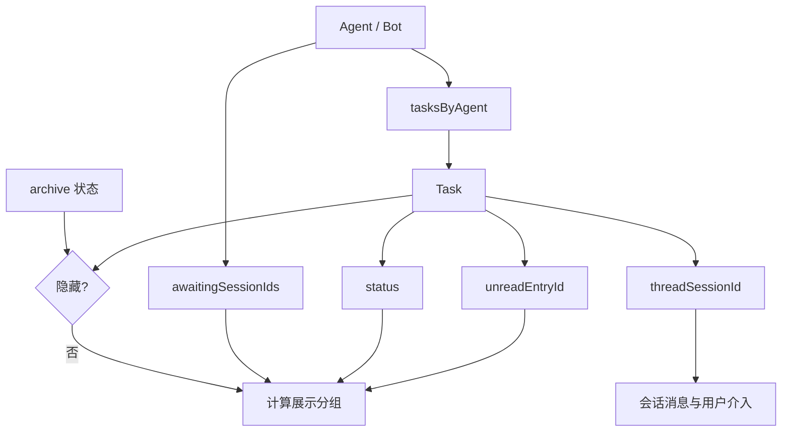
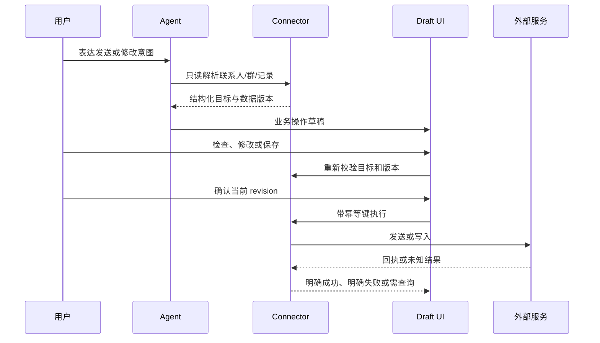
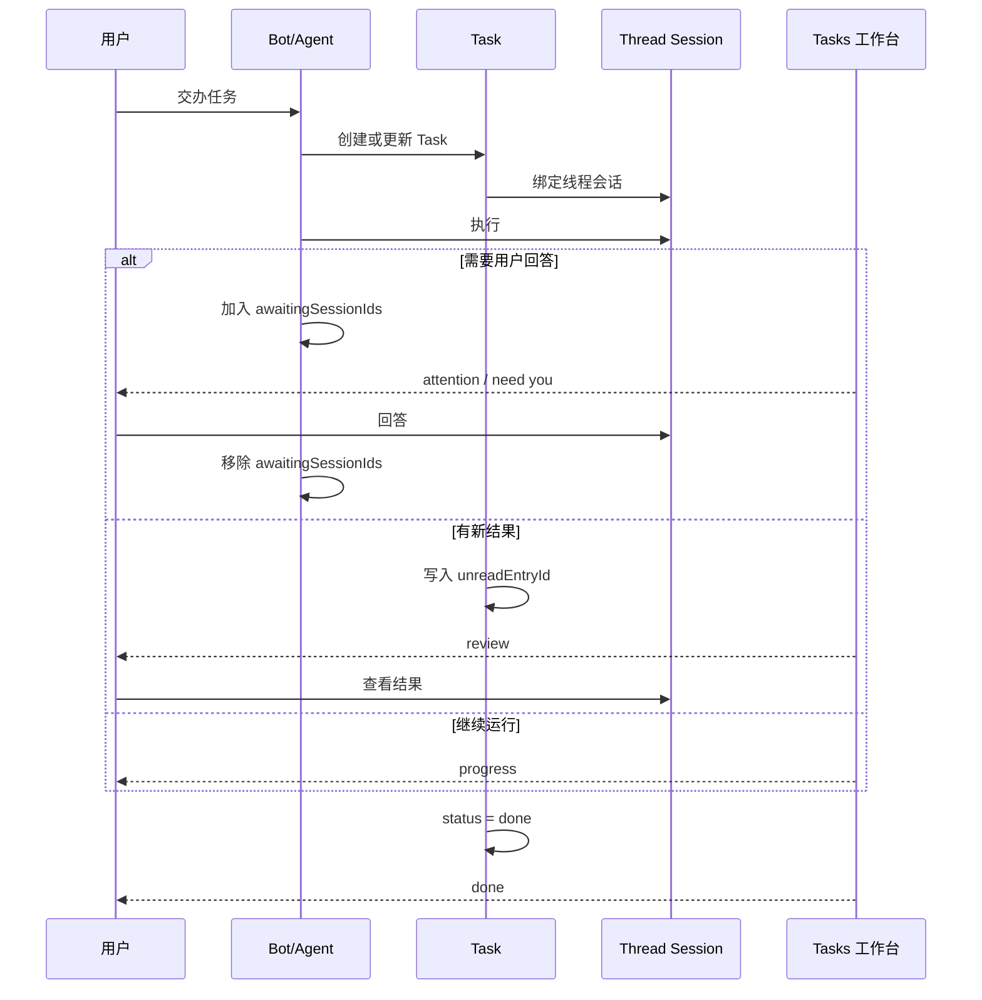

# Grok Bot 逆向逻辑梳理与 Moss 借鉴方案（Review 版）

日期：2026-11-03

状态：**方案 review 完成；实施与发布进度见 [交付记录](grok-bot-delivery-20261104.md)。本文保留原分批方案，不代表所有后续批次均已实现。**

关联证据：[REA 分析与初版建议](grok-bot-rea-analysis-20261103.md)、[静态证据摘录](../output/grok-bot-analysis-20261103/evidence-excerpts.md)、[REA 摘要](../output/grok-bot-analysis-20261103/rea-summary.json)。

本文把 Grok Bot 0.78.1 的静态逆向事实、对 Moss 的映射、实施设计和 review 结果放在一起。文中“已确认”只指安装包中能直接看到的客户端逻辑；没有把静态代码推断成已经验证的云端服务能力。

## 1. Review 结论

Grok Bot 最值得借鉴的不是“Bot”这个对象，而是它把长期工作拆成几个可观察的层次：

```text
职责固定的 Agent/Bot
  └─ 多个 Task
       └─ 每个 Task 对应一个线程会话
            ├─ 执行中
            ├─ 用户需要回答或确认
            ├─ 有新结果需要查看
            └─ 已完成
```

它再把自动化、业务操作草稿、知识审核、共享账号和演示教学挂在同一个 Agent 之下。用户因此可以交办工作，离开当前会话，稍后从任务入口继续处理；成功的方法也可以进入下一次任务。

Moss 已有相同的执行基础，但对象分布在“项目、会话、专家、App、Skill、Decision Broker、Cron、Agent Mail”中。建议采用以下产品决策：

| 决策 | 结论 | 原因 |
| --- | --- | --- |
| 是否新增 Moss Bot 实体 | 暂不新增 | 现有项目 + 专家/Agent + App + Skill 已覆盖职责、资源和执行上下文；新增 Bot 会制造重复语义 |
| 是否新建审批系统 | 不新建 | Decision Broker 已有持久化、过期、签名令牌、幂等响应和恢复逻辑 |
| 是否把消息中心改成待处理工作台 | 不改 | 消息中心保存通知历史；待处理只保存阻塞工作和需要查看的结果 |
| 第一优先级 | 跨会话待处理工作台 | 能立刻组织现有能力，减少用户遗留阻塞任务 |
| 第二优先级 | 业务操作草稿 | 让用户在真实外部副作用前检查目标、账号和最终字段 |
| 第三优先级 | 统一自动化详情 | 把定时、事件和试跑统一成可管理的运行对象 |
| 后续能力 | 演示教学、岗位方案、团队知识审核 | 复用价值高，但需要更多运行、权限和版本验证 |

**Review 结论：** 方向和拆分通过；在扩大范围前，待处理工作台需要补齐“结果 review 状态”和“计划确认去重”两个问题，业务操作草稿必须先落实账号、目标解析、版本校验和幂等执行，不能从一张可编辑文本卡片直接开始。

## 2. 证据等级和限制

### 2.1 证据分级

| 等级 | 含义 | 本文使用方式 |
| --- | --- | --- |
| A：直接静态事实 | 在可解析的 JS/CSS/JSON 中看到字段、分支、排序或 RPC 名称 | 可以描述客户端确定行为，例如 `review → attention → progress → done` |
| B：Moss 源码事实 | 当前工作区源码中已有的接口、状态和持久化 | 可以作为实现复用点和兼容边界 |
| C：产品归纳 | 根据 A、B 归纳出的用户体验和目标架构 | 作为设计建议，不能写成 Grok 后端已验证事实 |
| D：未验证能力 | 只出现文案、feature flag 或客户端接口，未有在线调用证据 | 只能列为待验证项 |

### 2.2 本次逆向的边界

- 样本是本机 `/Applications/Grok Bot.app`，版本 0.78.1；分析对象是安装包静态资源。
- ASAR 文本资源逐文件校验通过；整包检查因一个 unpacked 原生模块哈希差异终止，原生模块没有执行。
- REA 已分析任务聚合、草稿、自动化、教学、模板、知识审核、账号和表单等模块；证据摘录见关联文档。
- 没有登录、调用在线模型、发送邮件/消息、运行云端自动化或验证账号策略。因此不能从客户端接口推出云端一定支持某渠道、某账号或某副作用语义。

## 3. Grok Bot 的逻辑模型

### 3.1 任务、线程和 Bot 的关系

G1 的任务聚合代码给出了最清楚的关系：

1. 先遍历 `agents`。
2. 从每个 Agent 取任务列表 `tasksByAgent.get(agent.id)`。
3. 根据 Agent ID 和任务 ID 推导线程会话 ID。
4. 读取归档状态；归档中或已归档的任务不进入当前列表。
5. 根据任务状态、未读入口和 Agent 的等待会话集合计算展示分组。
6. 排序后按状态或 Bot 分组渲染。

可以还原为下面的逻辑关系：



安装包中能确认的字段语义如下：

| 对象 | 已确认的字段或行为 | 对 Moss 的映射 |
| --- | --- | --- |
| Agent/Bot | `id`、任务列表、`awaitingSessionIds` | 项目、专家/Agent、绑定的 App/Skill |
| Task | `id`、`status`、`unreadEntryId`、`updatedAtMs`、`unreadAtMs` | 项目任务或会话摘要；当前不要求新建 Task 表 |
| Thread session | 由任务和父会话推导的线程会话 ID | Moss 会话 `sessionId` |
| Archive | `archiving`、`archived` 等状态会过滤任务 | Moss 的 `archivedAt` |
| Automation | `id`、`trigger`、`isEnabled`、`runs` | Cron、App Channel、Workflow/App 事件运行 |
| Draft | 消息类型、业务目标、`draftSendState`、`draftRouteVerified` | App 操作草稿 |
| Review item | pending/approved/rejected、处理人和时间 | Moss 记忆晋升审核 |

### 3.2 任务分组状态机

G1 中的展示状态不是任务原始状态，而是一个派生值。等价伪代码如下：

```ts
function deriveGroup(agent, task, threadSessionId) {
  if (agent.awaitingSessionIds?.includes(threadSessionId) && task.status !== 'done') {
    return 'attention';
  }
  if (task.unreadEntryId !== undefined) {
    return 'review';
  }
  return task.status === 'done' ? 'done' : 'progress';
}
```

这里有三个容易误读的点：

- `attention` 优先于 `review`。如果线程既有未读又在等待用户，用户首先要处理阻塞问题。
- `review` 不等同于未读消息中心。它表示一个任务产生了需要用户查看的结果，入口仍然属于任务上下文。
- `done` 是展示分组，不代表历史被删除。Done 在状态分组中放到底部；按 Bot 分组时也单独放底部。

排序是固定的：

```text
review → attention → progress → done
```

同组按 `unreadAtMs ?? updatedAtMs` 从新到旧排序；待处理数量只统计 `review + attention`。代码还把归档中的任务过滤掉，所以“任务存在”不等于“当前工作台可见”。

### 3.3 “等待回答”的真实判断

Grok 不是扫描会话文本来判断等待回答。它维护 Agent 的 `awaitingSessionIds`，再把线程会话 ID与集合比较。Moss 的对应实现也应该读取可判定的运行态信号：

```text
有未解决 AskUserQuestion request
    → 等待回答

有未解决 Decision Broker decision
    → 等待确认

没有上述请求，但 projectSessionStatus = waiting_for_user
    → 只能作为兼容兜底，显示“项目任务等待处理”，不能伪造具体问题
```

当前 Moss 的 AskUserQuestion 请求包含 `requestId`、`sessionId`、`input`、`requestedAt`；回答或拒绝后主进程发送 `agent:question-resolved`。因此工作台不需要解释聊天文本，也不应该根据“请问”“请选择”等自然语言猜测阻塞状态。

### 3.4 业务操作草稿逻辑

G2/G3 证明 Grok 将“发送外部消息”视为业务对象，而不是普通工具参数：

- 邮件、Slack、会议聊天和 iMessage 有专门的 draft 消息类型。
- 草稿有 editable、sending、saving 等状态和后续终态。
- 邮件可以保存草稿或发送；Slack 至少展示 workspace、channel、thread 和正文。
- `draftRouteVerified` 单独表示路由已核验，说明“模型写了一个收件人”与“系统确认了实际目标”是两件事。
- 邮件比较收件人、抄送、主题和正文；Slack 比较 workspace、target、thread 和正文。
- 正文差异按词分段；匹配不可靠时返回无高亮，避免给出误导性局部差异。

可还原的操作链是：



### 3.5 自动化逻辑

G4 的客户端触发器分支至少包含 `cron`、`slack`、`github`、`microsoftTeams`、`linear`、`sentry`、`pagerduty`、`email`、`origin`、`webhook`。G5 的详情页同时绑定：

- `setEnabled`：暂停或恢复；
- `runNow`：试运行；
- 最近运行状态；
- 删除；
- 运行中的保护，避免把重复试跑当成普通空闲操作。

客户端没有把“触发条件”和“运行结果”拆成两个互不相干的页面。Moss 应借鉴这一点，但继续复用 Cron、App Channel 和 Workflow/App 的执行器。

### 3.6 演示教学逻辑

G6/G7 能确认一条完整的状态和 RPC 链：

```text
idle
  → startTeachRecording(agentId, entryPoint)
  → recording { agentId, startedAtMs, maxDurationMs: 600000 }
  → stopTeachRecording({ agentId, save })
  → “The recording is finished. Learn the task from it.”
```

状态管理包含计时器、重连查询、开始/停止串行保护和取消时的 best-effort stop。能确认的是录制入口和学习请求；不能确认录制数据如何编码、是否必然生成 Skill、再次运行成功率如何。

### 3.7 模板、知识、账号和表单

- Bot 模板包含 `instructions`、`memories`、`skills`、`context`、`routines`、`integrations/plugins`。这是一套工作配置，不只是 prompt。
- 知识审核有 `pending`、`approved`、`rejected` 和处理人/时间；`getBotSharedMemories` 与 `listBotReviewItems` 是客户端可见接口。
- 账号模型区分个人委托、服务账号和连接来源；共享岗位不能等价于共享个人凭据。
- 交互式表单支持 `secret`、`required` 和不同字段组件；Moss 应先复用 AskUserQuestion，只有字段多且需要一次性校验时才增加表单协议。

## 4. Grok 的完整用户流程

### 4.1 交办、执行和介入



### 4.2 草稿发送和未知结果

业务操作必须区分“请求已经发给外部服务”和“本地等待回包”。网络断线时不能把未知结果显示为失败后自动重发，也不能显示为成功。Moss 的操作草稿要把这三种结果分开：

```text
accepted/成功：有外部回执
failed/失败：明确知道未执行或外部返回失败
unknown/结果未知：需要按幂等键查询，禁止盲目再次发送
```

### 4.3 自动化试跑

试跑必须有独立标识，结果进入运行历史，并能跳回触发配置和承接该次会话。暂停只阻止新的运行，不应中断一个已经明确处于 running 的副作用，除非执行器提供取消语义。

## 5. Moss 的目标架构

### 5.1 对象映射

| Grok 概念 | Moss 现有对象 | 目标处理 |
| --- | --- | --- |
| Agent/Bot | 项目、专家/Agent、App、Skill | 继续组合，不新建同义实体 |
| Task | 项目任务、会话摘要 | 先做只读投影；需要跨设备历史后再考虑持久任务表 |
| Thread session | Moss session | 直接使用 `sessionId` |
| awaitingSessionIds | AskUserQuestion、Decision Broker、项目状态 | 由权威请求源派生 |
| unreadEntryId | 结果未读游标/消息聚焦 | 现阶段缺少统一字段，作为独立补充批次 |
| Draft message | App 操作草稿 | 由 App 负责业务字段，Core 负责统一展示和确认 |
| Automation | Cron、App Channel、Workflow/App | 统一详情和运行历史，不替换执行器 |
| Bot template | 项目指令 + 专家 + App + Skill 资源绑定 | 导出/导入岗位方案 |
| Shared memory review | 全局/项目记忆 + 版本 | 增加团队作用域和晋升审核 |

### 5.2 统一投影原则

工作台只读聚合，不能成为第二个执行器。每个来源继续拥有自己的权威状态：

```ts
type PendingWorkItem = {
  id: string;
  sessionId?: string;
  projectId?: string;
  source: 'question' | 'approval' | 'result' | 'failure';
  state: 'attention' | 'review' | 'progress' | 'done';
  title: string;
  summary: string;
  context?: string;
  createdAt: number;
  actionRef?: string;
  notificationId?: string;
  dedupeKey: string;
};
```

字段约束：

- `id` 是展示项 ID，不是外部执行 ID；
- `actionRef` 只用于回到原请求，不能让 UI 自行执行副作用；
- `dedupeKey` 必须由来源 ID 组成，不能由标题或摘要组成；
- `createdAt` 用于排序，不代表请求仍然有效；有效性必须回到 Broker/会话查询；
- 任何“确认”动作都要再次读取当前 revision、当前 Decision 状态或当前 Host confirmation。

## 6. P0-1：待处理工作台详细方案

### 6.1 产品目标

用户可以同时运行多个项目或会话，离开当前聊天后仍能回答问题、处理确认、查看结果和定位异常。工作台不承载普通通知历史，所以不会变成第二个消息中心。

首版展示四类事项：

| 展示状态 | Moss 来源 | 用户动作 |
| --- | --- | --- |
| 需要回答 | 未解决 AskUserQuestion；`waiting_for_user` 兜底 | 打开原会话，回答或拒绝 |
| 需要确认 | 未解决 Decision Broker、Host confirmation、Plan approval | 打开原确认面板或消息中心，确认/拒绝 |
| 新结果 | 有统一未读结果游标后进入 | 聚焦原会话中的结果 |
| 运行异常 | `projectSessionStatus = failed` 或明确终态错误 | 打开会话查看错误并继续处理 |

`progress` 和最近 `done` 用于让用户知道工作是否仍在推进，但不计入待处理数量。

### 6.2 当前第一版实现

当前工作区已经实现：

- [pending-work-items.ts](../ui/src/renderer-react/lib/pending-work-items.ts)：聚合问题请求、未解决 Decision Broker 通知和会话状态；
- [pending-work-panel.tsx](../ui/src/renderer-react/components/pending-work-panel.tsx)：扁平紧凑列表，按状态/项目分组，最近完成折叠；
- [App.tsx](../ui/src/renderer-react/App.tsx)：侧栏数量、来源跳转和原有确认流程复用；
- [app-sidebar.tsx](../ui/src/renderer-react/components/app-sidebar.tsx)：增加待处理入口；
- [notification-center.tsx](../ui/src/renderer-react/components/notification-center.tsx)：普通通知仍只在消息中心，确认通知可从工作台回到原处理入口。

当前“等待回答”以运行态请求为准：`window.agentDesktop.onQuestionRequest`、Web 重连 `snapshot.questions` 和 `waiting_for_user` 兜底。回答或拒绝后收到 `agent:question-resolved`，项目项随会话摘要更新消失。

### 6.3 UI 规范

首版遵循当前 Moss 风格：

- 页面标题使用小字号和边框分隔，不使用大面积插画或大卡片；
- 每行只保留一个状态点、标题、摘要、来源标签、项目和时间；
- 默认按“需要你处理 / 进行中”展示，“最近完成”折叠在底部；
- “按状态 / 按项目”是轻量切换，不再增加一组复杂筛选器；
- 普通应用通知不进入列表；
- 已读只影响消息中心，不会解除确认或回答阻塞；
- 点击行只导航到原上下文，不在工作台复制一套回答、审批和执行控件。

### 6.4 聚合算法

```ts
function buildItems(input) {
  const items = [];
  const sessionIdsWithQuestions = new Set(input.questions.map(q => q.sessionId));

  for (const q of input.questions) {
    addUnique(items, questionItem(q));
  }

  for (const decisionNotification of input.notifications.filter(isPendingDecision)) {
    addUnique(items, decisionItem(decisionNotification));
  }

  for (const session of input.sessions) {
    if (session.archivedAt) continue;
    if (session.pendingPlanApproval) addUnique(items, planItem(session));
    if (session.projectSessionStatus === 'waiting_for_user'
        && !sessionIdsWithQuestions.has(session.id)) {
      addUnique(items, fallbackWaitingItem(session));
    }
    if (session.projectSessionStatus === 'failed') addUnique(items, failureItem(session));
    if (isRunning(session)
        && !sessionIdsWithQuestions.has(session.id)
        && !session.pendingPlanApproval) {
      addUnique(items, progressItem(session));
    }
    if (isRecentCompleted(session)) addUnique(items, doneItem(session));
  }

  return sortByStateAndTime(items);
}
```

注意：`pendingPlanApproval` 和 Decision Broker 通知可能代表同一个计划确认。当前实现要在进入下一次合并前增加稳定的 `sessionId + decision kind` 关联，或者只保留 Decision Broker 项；不能依赖标题匹配消重。详见第 10 节的 review 问题 R-01。

### 6.5 跳转和失效处理

| 项目 | 打开动作 | 失效时行为 |
| --- | --- | --- |
| AskUserQuestion | `openSession(sessionId)` | 请求已解决/过期时刷新，显示“已处理”短暂提示 |
| Host confirmation | 查询当前 `confirmations.list()`，打开 `moss:show-confirmation` | 不以旧列表执行；请求不存在则回会话或显示已失效 |
| Decision Broker | 打开消息中心或对应决策入口 | Broker 再次校验 pending、签名和 revision |
| Plan approval | 打开会话中的 Plan 卡片或 Broker 详情 | 旧计划不能批准新 revision |
| Failure | 打开原会话 | 不自动重跑；由用户选择重试或修改输入 |
| Result review | 打开会话并聚焦结果消息 | 消息已读只改变 review 状态，不改变执行结果 |

### 6.6 验收矩阵

| 场景 | 预期 |
| --- | --- |
| 同时有多个项目等待回答 | 侧栏数量等于未解决问题数；切换项目后仍可找到全部事项 |
| 一个会话有多个问题 | 每个 `requestId` 唯一一项；回答其中一个不误删其他问题 |
| 通知已读但决策未处理 | 仍计入待处理；确认后从工作台移除 |
| Web 重连 | 以快照和权威列表恢复，不出现重复项 |
| 决策过期 | 不能继续执行，显示已过期并回到原上下文 |
| 计划确认同时有会话状态和通知 | 只显示一项，不能让用户确认两次 |
| 普通错误通知 | 只在消息中心，不进入待处理 |
| 运行中会话 | 显示进行中，不计入待处理数量 |
| 完成结果超过保留窗口 | 不进入最近完成列表，但会话历史仍可访问 |

## 7. P0-2：业务操作草稿详细方案

### 7.1 目标和范围

首批只做两类高频且容易核验的动作：

1. 发送内容：邮件、群消息、频道消息；
2. 修改业务记录：CRM 客户字段、工单字段或其他明确的结构化记录。

日历创建、批量删除、付款、外部账号授权等动作必须沿用同一契约，但不作为第一批交付。

### 7.2 Core 与 App 的边界

Core 不硬编码“收件人、频道、CRM 字段”的业务含义。每个 App/连接器负责：

```ts
interface OperationConnector {
  resolveTarget(input: unknown): Promise<ResolvedTarget>;
  readContext(target: ResolvedTarget): Promise<ReadonlyContext>;
  prepareDraft(input: DraftIntent, context: ReadonlyContext): Promise<OperationDraft>;
  validateDraft(draft: OperationDraft): Promise<ValidationResult>;
  execute(draft: OperationDraft, options: ExecuteOptions): Promise<ExecutionReceipt>;
  queryResult(resultRef: string): Promise<ExecutionReceipt | null>;
}
```

Core 负责统一展示、编辑、revision 校验、确认、幂等键、执行中状态和回执呈现。

### 7.3 通用草稿契约

```ts
type OperationDraft = {
  draftId: string;
  appId: string;
  channel: string;              // email / dingtalk / feishu / wecom / slack ...
  accountId: string;            // 实际发送身份，不由模型自由填写
  target: ResolvedTarget;
  content?: Record<string, unknown>;
  attachments?: AttachmentRef[];
  baseVersion?: string;
  revision: number;
  status: 'editable' | 'validating' | 'ready' | 'executing'
        | 'succeeded' | 'failed' | 'unknown' | 'expired';
  idempotencyKey: string;
  expiresAt?: number;
  resultRef?: string;
};
```

最小 `ResolvedTarget` 必须包含显示名、稳定 ID、账号/租户和目标类型。只显示“张三”或“销售群”不算解析成功。

### 7.4 草稿流程

1. 用户表达意图。
2. App 用只读 API 查联系人、群、频道、记录和当前版本。
3. App 返回结构化草稿；模型不能猜收件人、群或字段旧值。
4. Moss 展示发送账号、目标、频道/线程、正文、附件和影响条数。
5. 用户可以修改；每次修改递增 `revision`，旧确认立即失效。
6. 点击确认前重新读取目标和 `baseVersion`；同名目标变化时要求重新选择。
7. 执行携带 `idempotencyKey + revision`；重复点击只返回同一回执。
8. 网络结果未知时先 `queryResult(resultRef/idempotencyKey)`，禁止自动再发。

### 7.5 渠道扩展

候选渠道包括邮件、钉钉、飞书、企业微信、Slack、Microsoft Teams 和短信。每个渠道可以声明能力：

```ts
type ChannelCapabilities = {
  supportsCc?: boolean;
  supportsBcc?: boolean;
  supportsThread?: boolean;
  supportsAttachments?: boolean;
  supportsDraftSave?: boolean;
  supportsBatchUpdate?: boolean;
  requiresAccountSelection?: boolean;
};
```

UI 根据能力显示字段，不把 Slack 的 workspace、飞书的群和邮件的抄送强行统一成一个文本框。多渠道共享的是草稿生命周期和确认协议，不是业务字段。

### 7.6 安全和验收

- 多个同名联系人/群必须让用户选择；不自动取第一个。
- 显示实际账号和租户；个人账号、服务账号、委托账号分开。
- 附件只引用已解析的文件 ID/路径，执行前重新校验可读性和大小。
- 内容变更、目标变更、账号变更、基准版本变化都要求新确认。
- 成功、明确失败、结果未知必须分开；未知不能显示成功。
- 验收覆盖双击、刷新、断网、服务超时、联系人改名、记录版本变化、附件删除和权限撤销。

## 8. P0-3：统一自动化详情

### 8.1 首期只统一展示和管理

首期增强现有 Cron 详情，字段包括：

- 自然语言计划、原始 cron、时区；
- 关联项目、执行电脑、使用账号；
- 启用/暂停；
- 立即试跑；
- 下次运行、上次运行、运行中状态；
- 最近运行列表、结果、错误和承接会话入口。

标题优先显示“每周一 09:00（上海）”，原始 cron 放进详情，不让用户先读表达式。

### 8.2 事件触发第二期接入

先选择一个真实高频事件，例如钉钉/飞书指定群消息或 CRM 客户状态变化。App 提供事件解析和去重键，Core 维护：

```text
automationId
eventKey / dedupeKey
receivedAt
runId
status
sourceRef
sessionId
```

暂停后不再创建新运行；重连不会重复启动同一个 `eventKey`；试跑标记 `manual`，正式触发标记 `event` 或 `schedule`。

## 9. P1：演示教学、岗位方案和团队知识

### 9.1 演示教学

只从浏览器内单一重复任务开始：

1. 用户选择页面并开始录制；
2. 保存页面快照、操作、输入和结果，密码/验证码不写入共享步骤；
3. Agent 把日期、客户、输出位置等动态值抽成变量；
4. 生成可编辑 Skill 草稿；
5. 用另一组输入试跑；
6. 失败时允许用户接管，记录失败原因和修订。

验收至少包含两组输入、不同页面状态、刷新、权限弹窗、接管和取消。录制成功不等于 Skill 可复用。

### 9.2 岗位方案

岗位方案是以下资源的可移植版本：

```text
用途与边界
项目指令
专家/Agent 配置
App/服务依赖
Skill 引用及版本
自动化引用
输入/输出示例
```

导入时检查 App 是否安装、账号是否授权、Skill 版本是否存在；缺失项以可修复列表显示。个人聊天、凭据和未经选择的个人记忆不能进入方案包。

### 9.3 团队知识审核

个人任务中产生的规则先进入 `pending`，展示内容、来源会话、适用范围和差异；有权限的用户批准、拒绝或修改。批准后写入团队作用域，撤销时带版本号，避免旧摘要重新注入。

## 10. 本轮 Review 发现和处理意见

### R-01：计划确认可能出现重复项（P0，实施前修复）

当前 Moss 同时有：

- 会话摘要中的 `pendingPlanApproval`；
- Decision Broker 创建的 `plan_approval` 通知。

`pending-work-items.ts` 分别添加两项，而 App Notification 当前没有 `sessionId` 字段，不能稳定按会话和决策类型消重。用户可能看到两行“Plan 等待确认”。

**处理：** 给决策通知补稳定的 `sessionId`/`kind` 关联并在聚合层按 `sessionId + kind` 消重；或者规定工作台只收 Decision Broker 项，`pendingPlanApproval` 只作为会话内卡片。禁止按标题字符串消重。补充一个同时有摘要和通知的测试。

### R-02：`review` 状态目前没有真实来源（P1）

面板和类型支持 `review`，但 `SessionSummary` 没有统一的未读结果游标；当前聚合器只把完成会话放入 `done`，所以“新结果需要查看”尚未达到 Grok 的语义。

**处理：** 增加会话级 `lastReadResultAt` 或 `unreadResultId`，由 Host 在结果产生和打开结果时维护。没有可靠游标前，不能把所有完成会话都标成 review，否则会重新变成消息中心。

### R-03：普通通知与工作项的关联不完整（P1）

普通 App 通知没有统一的 `sessionId`，所以它们无法可靠跳转到具体会话。当前将其留在消息中心是正确的安全选择。

**处理：** 未来只有来源能提供稳定 `sessionId/actionRef` 时，才允许通知进入工作台；否则显示“查看消息中心”，不猜测归属。

### R-04：`waiting_for_user` 是兜底状态（P1）

它能说明项目任务等待处理，但不提供具体问题、选项或过期时间。若把它直接命名为“等待回答”，用户会以为工作台有可回答的问题。

**处理：** 保留“项目任务等待处理”文案；真正的回答项必须来自未解决请求。逐步让项目执行器发布结构化阻塞原因。

### R-05：工作台是投影，不是独立持久队列（设计约束）

当前列表由问题快照、通知列表和会话摘要实时计算。它不会接管任务执行，也没有自己的批准结果。这个约束减少了双写和状态漂移，但跨设备、进程重启和离线期间的统一历史仍需验证。

**处理：** 首期继续只读投影；需要跨设备任务历史时，再设计 Host 持久化 `pending_work_projection`，并以来源版本和来源 ID 做幂等更新。

### R-06：Grok 的 Task 与 Moss 的 Session 不能一对一假定（架构边界）

Grok 一个 Task 有独立 unread 游标和线程状态；Moss 当前一个会话可能承载普通聊天、项目任务、Cron 或 Agent Mail。不能仅凭 `busy` 把所有会话都当成 Grok Task。

**处理：** 只有项目任务、定时运行和明确的后台来源进入对应工作项；普通聊天只在有结构化问题、确认或结果游标时进入。

### R-07：静态证据不能证明云端副作用（证据边界）

草稿接口、Automation RPC、教学 RPC 和账号模块都只证明客户端有入口。它们不能证明某个账号已经获得某渠道权限，也不能证明发送和重放语义。

**处理：** 每个新增 App/Connector 必须用受控 fixture 验证目标解析、版本冲突、幂等回执和未知结果；文案和接口名称不能代替运行证据。

## 11. 推进批次和退出条件

| 批次 | 内容 | 退出条件 |
| --- | --- | --- |
| A：工作台修正 | 计划确认去重、结果 review 游标设计、过期和重连验收 | 无重复项；回答/确认/过期状态一致；普通通知不混入 |
| B：操作草稿 | 一个邮件/消息 App + 一个 CRM 更新 App | 目标解析、revision、幂等、未知结果和失败恢复通过 |
| C：自动化详情 | Cron 统一详情、试跑和运行历史 | 暂停、试跑、重复事件、错误回执和承接会话通过 |
| D：事件触发 | 接入一种真实事件源 | 去重键、暂停、重连和运行归属通过 |
| E：复用能力 | 浏览器教学、岗位方案、团队知识审核 | 第二组输入复跑成功；缺失依赖和知识版本可追溯 |

建议观察的产品指标：

- 用户从发现阻塞到处理完成的时间；
- 超过 24 小时未处理的项目数；
- 工作台项重复率和过期点击率；
- 操作草稿直接采用率、修改率和结果未知率；
- 事件重复启动次数；
- 教学任务第二次运行的成功率和人工接管次数。

## 12. 验证记录

本轮已执行：

- `bun test ui/tests/pending-work-panel.test.tsx ui/tests/pending-work-items.test.ts ui/tests/app-sidebar.test.tsx`：22 项通过；
- `cd ui && bunx tsc --noEmit`：通过；
- `cd ui && bun run build:renderer`：通过；
- 已对照 Grok G1–G14 静态摘录和 Moss 当前主进程、Decision Broker、通知中心、项目会话和 Cron 代码。

根目录执行 `bun run build:renderer` 会失败，因为该脚本属于 `ui/package.json`；正确命令是上面的 `cd ui && bun run build:renderer`。这只是命令目录问题，不是构建失败。

最终采用的实现顺序是：先修正工作台的两个 review 问题，再做一条真实渠道的业务操作草稿，随后统一自动化详情。只有在这三条链路的权威状态、回执和失败处理稳定后，才进入演示教学和团队复用。
