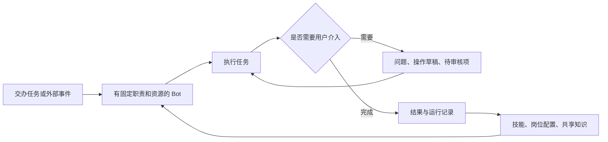

# Grok Bot 0.78.1：REA 逆向分析与 Moss 借鉴建议

分析日期：2026-11-03。对象为本机 `/Applications/Grok Bot.app`。本文记录 REA 逆向结果、Moss 借鉴方案，以及已实现的第一版“待处理工作台”UI。

**建议先做三件事：跨会话的待处理工作台、可编辑的业务操作草稿、统一自动化详情。其次做演示教学、可复用的岗位配置和共享知识审核。** Moss 已经有大量执行基础，主要增量在于让用户能交办、介入、复用和持续管理这些能力。

## 1. 样本与证据范围

| 项目 | 本次观察 |
| --- | --- |
| 应用名 / 版本 | Grok Bot / 0.78.1 |
| 构建时间 | 包内 `sandBuiltAt = 2026-10-28T02:34:00.517Z` |
| Bundle ID | `com.anysphere.sand` |
| 包内信息 | `name: sand`，`author: SpaceXAI`，大量 `@anysphere/*` 依赖；这些只作为样本元信息，不据此推断产品归属变化 |
| 客户端结构 | Electron 主进程、React renderer、preload、local-exec-daemon、node-agent-coordinator |
| ASAR 清单 | 899 个文件条目；选择并核验提取 685 个 JS/CJS/MJS/JSON/HTML/CSS 文件 |
| REA | 6.5.0；两组共分析 9 个不同 JS 文件，解析失败 0；其余模块通过静态阅读补充 |
| Moss 对照基线 | HEAD `9a10cbd7b638ff3cefbf6225d577cc96a241cdce` 加分析时工作区已有未提交修改；不是只看旧文档 |

整包 `rea inspect-artifact` 因 unpacked `jpeg-napi.darwin-arm64.node` 的实际哈希与 ASAR 声明不同而终止。随后只提取需要的文本资源：ASAR header 的 SHA-256 与 Info.plist 声明一致，提取的 685 个文件逐一与 ASAR 内声明的 SHA-256 比较通过。原生模块没有执行，也没有把整包认定为全部校验通过。

REA 证据：

- 8 个功能模块：`ev_1b53240a344babb7da0dbc118ebf403da6ac1de96cc84976e440ff075fc53a14`，94,865 个 AST 节点。
- 主 renderer bundle：`ev_78ba833a9d8287beb0b81480a6dd5165b19eb74e95e35863d24637700b7b8b67`，1,457,803 个 AST 节点；语义图触及结果预算，保留静态事实，不能视作完整调用图。
- [提取与哈希清单](../output/grok-bot-analysis-20261103/manifest.json)、[REA 摘要及限制](../output/grok-bot-analysis-20261103/rea-summary.json)、[代码证据摘录 G1–G14](../output/grok-bot-analysis-20261103/evidence-excerpts.md)。证据保存在本机 `output/`，不随 Git 文档自动分发。

本轮是**安装包静态逆向**：确认了客户端的数据结构、界面分支和操作接口；没有登录操作、调用在线模型或验证云端任务成功率。功能可能受账号、组织策略或 feature flag 控制。翻译文案只用作补充线索，不单独作为功能已经可用的证明。

## 2. 产品组织方式中值得学习的部分

从任务聚合、Bot 配置、草稿和例行任务代码看，它围绕一个持续存在的 Bot 组织工作：Bot 拥有任务、上下文、技能、连接器和例行任务；用户在需要时介入，完成的工作可以继续沉淀成可复用配置。

这是对客户端可见功能的产品归纳，不是已经恢复的云端执行架构。Moss 可以将它映射到现有“项目 + 专家/Agent + App + Skill”，避免再增加一套含义重叠的 Bot 对象。

## 3. 建议优先级

以下收益与成本是对 Moss 的实现判断，不是竞品实测指标。

| 优先级 | 功能 | 对用户的具体价值 | Moss 当前基础与增量 | 相对成本 |
| --- | --- | --- | --- | --- |
| P0 | 跨会话待处理工作台 | 同时交办多个任务后，一眼知道哪些需要回答、确认或查看结果 | 已有通知、Decision Broker、项目任务 attentionCount；补跨项目聚合与精确跳转 | 中 |
| P0 | 可编辑的业务操作草稿 | 发邮件、改 CRM、建日程前直接检查和修改最终内容 | 已有工具权限卡、Host 确认、项目创建草稿；补业务字段、修订、执行回执 | 中 |
| P0 | 统一自动化详情 | 看懂触发条件、何时运行、在哪运行、最近结果；能暂停和试跑 | 已有 Cron、独立运行会话、App Channel、Workflow；补统一展示与事件触发适配 | 展示中，事件接入中至大 |
| P1 | 演示一次，生成可复用方法 | 不会写 Skill 的用户也能教会 Moss 处理重复业务 | 已有浏览器和电脑操控 App；缺录制、步骤提取、参数化和验证流程 | 大 |
| P1 | 可复用的岗位配置 | 把“销售运营助手”整体复制给同事，减少逐项配置 | 已有项目指令、专家、App、Skill 资源绑定；补可移植配置、依赖检查、版本 | 中 |
| P1 | 个人学习晋升为共享知识 | 团队经验可以积累，个人偏好不会直接成为所有人的规则 | 已有全局/项目记忆、来源、纠错和版本；补团队作用域与晋升审核 | 中 |
| P2 | 连接器使用身份可见 | 清楚当前操作使用谁的账号，共享职责变化后可恢复 | 已有 App 配置和权限基础；需明确个人/服务账号/委托身份 | 大 |
| P2 | 岗位效果统计 | 看任务完成率、人工介入次数和实际产出 | 已有 trace、用量、执行记录；补业务结果口径 | 中 |

## 4. P0：跨会话待处理工作台

### Grok Bot 的可验证实现

G1 中的任务聚合遍历多个 agent 的任务，并依据线程会话状态分为：

- `review`：有未读结果或新回复，需要查看。
- `attention`：该线程在 `awaitingSessionIds` 中，需要用户回应。
- `progress`：正在处理。
- `done`：完成；仍有未读内容的任务可优先归入 review。

排序优先级是 `review → attention → progress → done`，同组按时间排序；待关注数量只统计前两组。支持按状态或按 Bot 分组。该路径还检查 `harness === temporal` 等条件，因此不能理解为所有账号的全部任务都必然进入此页。

### Moss 应如何借鉴

Moss 已有三个相邻入口：[通知中心](../ui/src/renderer-react/components/notification-center.tsx)、[Host 待确认](../ui/src/renderer-react/components/host-confirmations.tsx)、[项目会话列表](../ui/src/renderer-react/components/projects/project-tasks-tab.tsx)。[Decision Broker](../ui/src/decision-broker.mjs) 已处理持久决策、过期和重复响应，不能把这项建议写成“从零开发审批系统”。

新增一个跨会话“待你处理”视图，聚合现有来源，分别展示“需要回答”“需要确认”“新结果”“运行异常”。每项显示任务、来源项目、阻塞原因、等待时间和对应操作，点击到具体消息或请求。

**示例：** 用户同时安排“整理销售周报”“更新客户跟进”“发送供应商邮件”，回来后看到“1 个结果可查看、1 个字段待补、1 封邮件待发送”，可以逐项处理。

技术上先建立统一的只读投影：`sessionId + sourceType + sourceId + state + actionRef`。决策仍交回原 Broker，任务状态仍由原执行器负责。已读状态和决策完成状态分开处理。第一阶段不改成打断用户的全局弹窗。

**验收：** 切换项目仍能找到所有未决事项；重连后数量一致；同一请求不会重复出现；已读不等于已批准；已过期项不能继续执行。

### Moss 第一版实现记录（2026-11-03）

已将上述只读投影落到 Moss：

- 新增 [pending-work-items.ts](../ui/src/renderer-react/lib/pending-work-items.ts)，统一聚合 AskUserQuestion、未解决的 Decision Broker 决策和项目会话状态；普通应用通知继续只归消息中心，避免两个入口重复。
- 新增 [pending-work-panel.tsx](../ui/src/renderer-react/components/pending-work-panel.tsx)，采用紧凑的任务列表，默认按“需要你处理 / 进行中”展示，最近完成折叠在底部，并支持“按状态 / 按项目”切换；行内保留需要回答、需要确认、运行异常等具体标签。
- 侧栏新增“待处理”入口。会话类事项打开原会话；主机确认继续打开现有确认弹窗；Decision Broker 通知打开现有消息中心；没有新执行器或第二套权限流程。
- 已读通知不会隐藏待确认决策；普通通知不会进入工作台；完成结果只保留最近 7 天，避免工作台永久累积历史。

验证：新增 `ui/tests/pending-work-items.test.ts` 覆盖排序、去重、已读决策和过期结果；随后运行受影响的 UI 测试与 TypeScript 检查。当前限制是应用消息本身没有统一的 `sessionId` 字段，无法可靠关联到具体会话时仍会在消息中心处理。

## 5. P0：可编辑的业务操作草稿

### Grok Bot 的可验证实现

G2/G3 和接口清单显示邮件、Slack、会议聊天及 iMessage 有专门的 draft 消息类型，提供 `sendDraft` / `discardDraft`；邮件还区分保存草稿状态。界面区分 editable、sending、saving 和后续终态，并保留 `unconfirmed` 这类未确定结果的状态。

它还比较上次与本次邮件/Slack 草稿：正文新增内容、收件人、抄送、主题、workspace、channel、thread 都可进入变化高亮。正文按词对齐，包含 `Intl.Segmenter`；无法可靠对应时不会强行给出局部高亮。已经核验的发送路由有独立的 `draftRouteVerified` 字段。

这比“展示一段文字后问是否允许调用某工具”多了一层业务表达：用户知道最终将向谁、在哪个账户下、发送什么。

### Moss 应如何借鉴

[ToolPermissionCard](../ui/src/renderer-react/components/chat/tool-permission-card.tsx) 已支持文件 diff、命令和通用参数；[Host confirmations](../ui/src/host/confirmations.mjs) 已按内容哈希校验用户确认的版本；[项目创建服务](../ui/src/project-creation-service.mjs) 已有版本化草稿和确认后执行路径。这些是可直接复用的基础。

第一批只做两类：

1. **发送内容：** 收件人/群、账号、正文、附件，可修改后发送，也可只保存。
2. **修改业务记录：** 对象名称、字段旧值/新值、影响条数，可修改后提交。

Core 提供通用“操作草稿”契约，具体字段与提交适配由邮箱、CRM、日历 App 负责。建议包含 `draftId/revision/target/fields/status/resultRef`；确认绑定当前 revision，修改后生成新 revision；执行以幂等键防重，网络结果未知时先查询回执，不能盲目再发一遍。

**示例：** “把这 12 个客户的下次跟进时间改成周五”返回一张可检查的变更表；用户删掉两行、改一个日期后提交，结果明确显示实际更新的 10 条。

**验收：** 修改后发送的是最新字段；旧确认不能批准新版本；双击只执行一次；失败保留编辑内容；结果未知与明确失败分开呈现。

## 6. P0：统一自动化详情

### Grok Bot 的可验证实现

G4 的客户端触发器分支包括 cron、Slack、GitHub、Microsoft Teams、Linear、Sentry、PagerDuty、email、origin 和 webhook。G5 中同一个详情页连接 `setEnabled`、`runNow`、删除及最近运行状态；有运行中的判断，避免按钮把重复试跑当成普通空闲操作。Webhook 另有地址、密钥和请求头说明。

这些证明客户端把“什么时候运行”和“任务内容”作为可管理对象。各集成是否已配置、云端触发可靠性和重放语义不在本次验证范围内。

### Moss 应如何借鉴

Moss 的 [CronView](../ui/src/renderer-react/components/cron-view.tsx) 已有启停、立即运行、下次运行、上次完成和执行会话跳转；[调度器](../ui/src/moss-cron-scheduler.mjs) 已为每次运行创建独立会话并保留历史。App Channel 已有持续会话和投递队列，[Workflow](./workflows.md) 也已有执行记录。缺口主要是统一产品入口与各类触发来源的接入。

第一阶段增强现有定时详情：自然语言计划、时区、执行电脑、关联项目、最近运行列表、结果、错误和继续处理入口。把原始 cron 放在详情中，主标题优先显示“每周一 09:00（上海）”。

第二阶段让 App 提供事件触发器，统一映射到现有会话执行；先接一种真实高频事件，例如飞书/钉钉指定群消息或 CRM 客户状态变化。Core 只维护通用任务身份、事件去重和运行状态，业务事件解释留在 App。

**示例：** “每周一生成销售周报”和“客户三天没跟进时提醒负责人”在同一个自动化入口管理，详情里清楚显示各自的触发条件。

**验收：** 同一事件不会重复启动；暂停后不再创建新运行；历史结果可追问；试跑与正式触发有标识；离线/重连不会把未知结果报告为成功。

## 7. P1：演示教学

### Grok Bot 的可验证实现

G6/G7 和录制控件显示一条完整的客户端操作链：开始演示 → 显示录制状态与时间 → 停止并保存或丢弃 → 向对话显示“录制已完成，请从中学习这项任务”。接口包括 `startTeachRecording`、`stopTeachRecording({save})`、`getTeachRecordingStatus`。客户端状态含 agentId、startedAtMs、maxDurationMs，初始上限为 600,000ms；重连重新查询状态，开始/停止有并发序列保护。

**已确认的是录制入口、状态管理和学习请求；尚未确认录制的云端编码方式、是否必然生成 Skill，以及再次执行的成功率。** 不能仅凭“从演示中学习”文案断言存在成熟的通用 RPA 学习系统。

### Moss 应如何借鉴

当前电脑操控已迁入相邻 `moss-apps/apps/computer-use`，Host 在 [desktop-control/feature.mjs](../ui/src/desktop-control/feature.mjs) 管理控制占用、权限和生命周期；浏览器执行由 browser-use App 提供。旧 CUA 文档里的 Core 原生实现路径已经不足以代表当前架构。

建议从**浏览器内的单一重复任务**做试点：

1. 用户点“教 Moss 做这件事”，选择目标页面并录制一次。
2. 保存关键页面、操作、输入与结果；密码和验证码不写入可分享步骤。
3. Agent 整理步骤，把日期、客户名称、输出位置等变量单独列出，生成可编辑 Skill 草稿。
4. 用户换一组数据试跑；需要时接管，修正后更新 Skill。
5. 验证通过后再用于重复任务或定时执行。

**示例：** 在 CRM 中筛选本周未跟进客户并导出表格。以后用户只需说“按上次的方法导出华东区客户”。

**验收：** 至少用不同输入和不同页面状态复跑；记录失败原因及接管次数。首版成本主要在录制和复跑验证，不能把它排成一个简单按钮需求。

## 8. P1：可复用岗位配置与团队知识

### 岗位配置

G8 的 Bot 模板明确包含 description/instructions、memory、skills、routines、plugins，并有发布、更新和创建副本相关界面。因此它分享的是一套工作配置，而不只是一个提示词。

Moss 已能用自然语言创建项目并绑定 App、专家和 Skill；优先把现有配置包装成可导入的“岗位方案”，例如“销售运营”“供应商采购”“售后回访”。模板声明用途、输入/输出、资源依赖和版本；导入时检查缺失 App 和登录状态，再创建项目。个人聊天、账号凭据和未经选择的记忆不进入分享包。

它与已有 Word/PPT/Excel 成品模板不同：这里复用的是岗位工作的配置与方法。首版可以只支持导出/导入、检查依赖，不必先做新的公共市场。

### 团队知识

G9/G10 有 `getBotSharedMemories`、`listBotReviewItems`、`resolveBotReviewItem`，状态为 pending/approved/rejected；知识页提供批准、拒绝以及处理人/时间信息。客户端文案还区分个人记忆和团队记忆。服务端如何抽取和合并知识没有恢复。

Moss 已有 [全局/项目记忆展示](../ui/src/renderer-react/components/memory-overview.tsx)、[ProjectMemory](../src/tools/ProjectMemoryTool/ProjectMemoryTool.ts) 纠错入口和 [项目记忆版本](../ui/src/project-memory-service.mjs)。值得补的是“将个人任务中学到的方法建议推广给团队”：展示内容、来源会话、适用范围和修改差异，再由有权限的人处理。

**示例：** 某客户要求“报价均附税率说明”先属于该客户/项目；销售负责人决定是否将它提升为团队报价规范。

**验收：** 未晋升内容不会进入团队通用指令；能追溯来源和版本；撤销规则后不会被旧摘要重新恢复。

## 9. 其他功能的取舍

| 观察到的设计 | 证据强度 | 对 Moss 的判断 |
| --- | --- | --- |
| 交互式补参表单 | G13 有 secret、required、不同字段组件及 submitUserForm 接口 | 复用现有 AskUserQuestion，优先改善业务字段表达；仅在需要多个结构化字段时加入表单 |
| 自然语言自动审核规则 | G12 有 allowInstructions/blockInstructions、去重和长度/数量上限；设置文案区分团队规则 | 有价值，但本轮只恢复配置和界面，未恢复审核模型；可先做确定性的业务规则，并保留现有权限链 |
| 个人账号、服务账号、委托账号 | G11 有 delegated/source、服务账号分支、断开后重新分享状态 | 企业使用很重要；适合在共享岗位落地后推进，避免把“共享 Bot”直接等同于“共享个人权限” |
| 主 Bot | 有 getMainAgent/setMainAgent/ensureDefaultMainAgent；文案描述协调其他 Bot 和主动联系 | Moss 的主会话与协调模式已有相邻能力；可借鉴固定入口，主动巡检的调度机制未核验 |
| 多渠道使用同一个 Bot | Slack/Teams 配置模块与文案表明复用 Bot 的插件、上下文和记忆 | Moss 已有 Agent Channel 与飞书等 App；重点校验身份、资源和上下文一致性，不必新增消息框架 |
| Bot 使用分析 | 有 analytics 页面、getBotAnalytics、feature flag；文案出现活跃用户和节省时间 | 可补任务成功率、人工介入率、复用次数；“节省工时”应说明估算依据 |
| 会议、电话、支付与保险库 | 有专门模块、消息类型及支付/通话接口 | 属于更重的服务集成；当前优先级低于上述办公工作流程，包内 UI 不证明后台服务在此账号可用 |
| 头像、桌面挂件与外观 | 有独立头像编辑器、desktop-mount 资源 | 可以改善个性化，当前对 Moss 的任务完成体验收益较小 |

## 10. 可实施的推进顺序

**第一轮：把现有能力组织好。** 完成待处理工作台；增强 Cron 详情和历史结果入口。复用 Decision Broker、项目会话 attentionCount、现有运行会话，避免替换执行器。观察“用户发现阻塞到处理完成的时间”和“遗留未处理任务数”。

**第二轮：让用户能检查具体业务结果。** 为一个邮箱或消息 App、一个 CRM 写操作接入操作草稿；支持修改、修订确认、幂等提交和实际结果回执。再接一种真实事件触发器。观察草稿直接采用率、修改率和重复执行次数。

**第三轮：让方法可复用。** 做一个浏览器演示教学试点；将验证后的 Skill 与项目资源组成岗位方案；团队知识晋升使用统一待处理入口。观察第二次任务能否成功、需要几次人工接管、岗位方案是否能被另一用户独立使用。

本轮结论的实际落点是：**让 Moss 同时承担多个工作后，用户仍能看清进展、轻松介入，并把成功的方法留给下次使用。**
