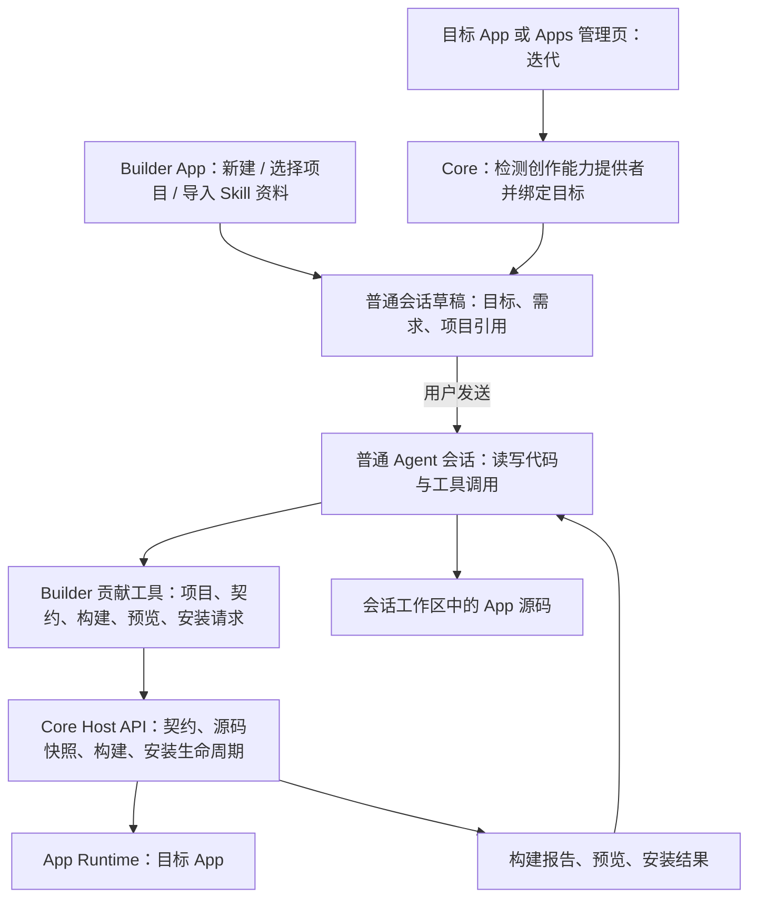

# App Builder 独立 App 迁移规划

日期：2026-10-10。状态：代码实现已落地，正在按验收门槛记录结果。最新实现、实际套件映射、测试证据及未完整验证项见 [实现与验收记录](app-builder-app-implementation.md)。本文保留两轮 review 后的设计和全部 68 个验收编号，不将已有测试等同于所有发布门槛已通过。

代码基线：Moss `811e949c`，Host API / SDK / Runtime `3.0.0`。仓库中已有的市场下载相关未提交改动不属于本计划。复核记录见 [方案 review](app-builder-app-review.md)。

## 1. 已确定的产品边界

- 创建一个独立的 `moss.app-builder` App，源码放在相邻 `moss-apps/apps/app-builder/`，通过现有应用市场或本地安装包分发。
- 新建 App、迭代已有 App、从 Skill 源文件转换为 App，都从 Builder 或目标 App 入口转入普通本地 Agent 会话。
- Builder 提供项目选择、需求草稿、源码状态、会话入口和产物信息；会话中的 Agent 完成分析、文件修改、构建、预览和安装请求。
- 创建流程不依赖专用 Assistant、Skill 加载器、独立模型配置或 Builder 内嵌聊天。Skill 仅可作为转换输入资料，不执行 `SKILL.md` 指令来接管流程。
- 目标 App 的迭代入口依赖可用的 Builder。Core 管理页、嵌入式 App 容器和独立窗口共用检测逻辑；业务 App 可以通过 SDK 查询同一状态并提供自己的按钮。
- 只面向最新 Host API。以当前运行的最新版 Core 所提供的完整契约与 SDK 快照为准；当前基线为 `3.0.0`。不实现多版本适配器。
- 本轮范围是 Desktop 本地会话。既有 App Runtime、普通 Agent、工具权限和安装管理继续作为公共底座。
- 本文的“安装新版本”指本机安装和激活；应用市场公开发布仍走独立签名/Release 流程，不由用户描述自动触发。

**工具归属约束：五个面向 Agent 的 Builder 工具，其名称、描述、JSON Schema、effect 和 Action 实现在 Builder App 包内。Core 不新增或保留同名模型工具、专用内置工具组或助手提示词；Core 只实现通用 App contribution 适配器与 Host handler。七个旧工具现已删除，实际 ZIP 的五个动态贡献工具已验证。**

## 2. 目标链路



复用 [app-composer.mjs](../src/apps/app-composer.mjs) 的资源准备和 [App.tsx](../src/renderer-react/App.tsx) 的普通会话发送链路。准备草稿时不写源码、不运行模型、不构建、不安装；用户发送后才创建普通会话或继续用户选择的已有会话。

不使用 `moss.agent-execution/v1` 再启动一层 Builder Agent。它与“最终都进入普通 Agent 会话”的需求无关，而且当前后台 App Agent 会过滤调用 App 自身的工具，不能作为 Builder 工具的递归执行入口。

## 3. 用户流程

### 新建

1. 打开 Builder，点击“创建 App”，填写需求，可选择工作区。
2. Builder 准备普通会话草稿，附带创建意图和项目引用；Agent 继承普通会话的模型、工作区与权限。
3. 发送后，Agent 读取最新开发契约，准备项目和 SDK，在工作区编写代码。
4. Agent 调用 Builder 工具构建和验证，打开目标 App 的真实预览。
5. 根据用户反馈继续在同一会话修改；用户要求安装时进入 Core 现有安装授权与激活流程。

### 迭代

1. Core 查询 Builder 是否可用；可用时才显示“迭代”。目标 App 不需要依赖 Builder 的源码或内部 Backend Action。
2. 点击后固定目标 App 身份、基准版本和源码来源，准备带有“修改此 App”上下文的普通会话草稿。
3. 已有项目可选择继续对应会话；默认不挪用当前无关会话，也不把焦点窗口当成授权来源。
4. Agent 发送首个准备请求时，Core 检查源码状态，在新目录或已绑定项目内安全准备源码，保护未提交改动。
5. 修改、构建和预览完成后安装新版本。提交时再次校验目标当前版本及构建摘要，发现并发更新则返回冲突。

### 连续迭代与会话绑定

首个会话草稿只有 `draftRef` 和固定的目标信息，不提前创建源码项目。首次 `builder_prepare` 成功后，Core 原子保存会话到 `projectRef` 的绑定，并通知前端更新通用 App context；该记录不能只依赖工具结果中的文字或 Renderer 内存。

| 时点 | 权威状态与后续行为 |
| --- | --- |
| 首次准备 | Builder 返回业务项目 ID；Core 将其与 owner、provider、真实工作区、目标及基准绑定，生成 projectRef |
| 普通续聊 | 从 Core 持久会话绑定恢复 projectRef；同项目源码复用，不能每轮重新抽取覆盖 |
| 本项目安装成功 | Core 用 release 回执推进基准版本和 installationRevision；Builder 的业务索引按回执对账，下一轮可继续修改，无需重新进入迭代入口 |
| 别的会话/市场更新目标 | 保留当前草稿基准与源码；可继续讨论、查看差异和修改；构建标记基准过期，提交拒绝冲突，不能悄悄换基准 |
| Builder 停用或暂不可用 | 仍允许普通会话讨论和查询 Core 已有操作摘要；不执行 Builder 工具，也不因一次 provider resolve 失败拒绝用户整条消息 |
| 更换目标或工作区 | 显式开启/选择另一个项目绑定；旧未完成草稿保留，不覆写同一 projectRef 的目标 |

projectRef 是持久项目引用，不是执行授权；原会话空闲时可以显式接续同一草稿。两个会话并行编辑同一目标时，project.prepare 为后来的会话创建独立草稿引用和源码目录，并记录共同来源；不能让两个普通 Agent 同时写同一目录后仅靠安装 CAS 保护。Core 保存路径/归属/基准/回执，Builder 保存标题、需求和产品分析等业务资料；不各自维护一份可独立决定安装版本的真值。

初始目标引用过期时，在首次写入前显示差异并重新准备；单纯提问不会触发换版本、源码抽取或安装。普通会话直接发现 Builder 工具时也走同一 prepare/bind 流程，不以是否从 App 页面进入决定权限。

### Skill 转 App

Builder 的“从 Skill 创建”选择一个源目录，把它作为创建输入转入普通会话。保留原转换工具包的静态清单、依赖分析、能力映射和业务验证思路；分析资源、模板和校验实现迁入 Builder 普通资源目录，不再分发或加载转换 Skill。

Agent 将 Skill 文本视为待分析资料。外部服务、凭据、固定 CLI 等依赖需要在目标 App 的实现与验证中处理；缺少依赖时报告具体缺口，不用演示数据宣称转换完成。

## 4. Builder 检测与跨 App 入口

### 声明与路由

拟在现有 `contributes.resourceProviders[]` 上增加一个窄的声明字段：

```json
{
  "id": "projects",
  "schemes": ["moss-app-project"],
  "listAction": "composer.list",
  "resolveAction": "composer.resolve",
  "authoring": { "target": "moss-app", "intents": ["create", "edit"] }
}
```

该 schema 已同步到 Manifest Schema、normalize、SDK 类型、Runtime contribution 收集和验证。Core 验证 provider 对应的 Backend Action 存在，不识别 Builder 的产品提示词。

Core 从已启用、兼容且拥有必要权限的 provider 中发现创作入口，不根据展示名称或工具名称猜测。首版要求同一目标类型只有一个可用 provider；重复声明返回明确冲突，不静默选择。

发现时逐个 App 隔离无效/不兼容包。一个无关 App 的包读取失败不能让所有创作入口消失。`moss-app-project` 用于项目身份；若接入文件附件解析，provider 必须对 URI 分支返回真实的受控文件结果，不能把 composer 的 instruction 返回值当文件使用。

所有对外跨 App 请求只路由“为此目标准备创作会话”这一意图。目标 App 不能指定任意其他 App、Action、system prompt、工作区或会话 ID。Core 用真实 sender 识别目标 App，用可信会话记录解析工作区，再调用发现的 Builder provider。Builder 内选择其他 App 时，使用 Core 返回并验证的目标引用。

### 显示规则

| 状态 | 迭代入口 |
| --- | --- |
| Builder 未安装、停用、包不兼容，或未贡献创作能力 | 隐藏 |
| 必需权限被撤销、配置缺失、provider 冲突 | 隐藏；Builder 管理页显示原因 |
| `on-demand` Backend 正常处于 stopped/idle | 显示，点击时按需启动 |
| Builder 启动失败、持续崩溃 | 禁用并提供重试或打开管理页入口 |
| 检测后 Builder 被卸载、撤权或升级 | 点击/工具调用时复查；旧执行请求拒绝，普通会话仍可发送消息 |
| 目标 App 已停用，但有有效身份与可恢复源码 | 可以进入迭代；不要求先启动目标 Backend |
| 目标 App 不兼容最新 Host，但源码可恢复 | 可以进入源码迁移会话；不能运行旧包 |
| 目标 App 只有编译产物 | 入口可带入源码补充流程，不能直接声称可完整编辑 |

安装、启停、权限、版本和 Backend 故障事件更新缓存；页面初始加载和重新获得焦点时复查。增加通用 `authoring.changed` 事件供 App SDK 使用，查询失败默认不显示可执行入口。正常 idle 不能被误判为不可用。

Core 自己的管理页与 App 容器提供统一入口，使现有 App 不必全部重发版本。业务 App 如需内部按钮，再通过最新 SDK 接入相同的查询/准备接口。

## 5. Core 提供的契约

下列方法名与字段是本次新增契约，已实现版本以 `packages/host-contracts` 和运行时开发目录为准。现有 `host.request` 传输、权限检查、来源绑定、取消和结构化错误继续复用。

### 公开开发信息与运行时能力

| 协议 / 方法 | 语义与边界 |
| --- | --- |
| `moss.host/v1 / info.get` | 返回 `hostApiVersion`、`sdkVersion`、`manifestSchemaVersion`、`contractHash`、`sdkHash`；描述本次实际运行的 Core |
| `moss.host/v1 / contracts.list` | 按 kind 分页列出 manifest、UI bridge、Host 协议/事件、Backend Service 及 SDK 公共导出的契约摘要 |
| `moss.host/v1 / contracts.get` | 按 kind/member 及固定 contractHash 读取完整 schema、权限、允许的 App ID/调用端、错误、限额和取消/幂等语义；Host 方法使用 protocol/method 定位 |
| `moss.host/v1 / sdk.export` | 在绑定项目中准备同一快照的 App SDK、Host contracts 和依赖锁定信息，返回路径与校验和；不导出 Core 私有模块 |
| `moss.host/v1 / capabilities.get`（已有） | 继续返回调用 App 已声明协议下的 supported/allowed/available；不扩大其授权语义 |

开发契约是公开静态元数据，Builder 可以读取尚未在自己 manifest 中声明的目标协议；读取说明不获得调用权限，也不包含其他 App 的配置、凭据或会话数据。未来目标 App 仍需声明并获得自己的权限。

契约来自 `packages/host-contracts` 及其他公开协议的现有定义。Account、Agent、OpenIM 尚未完全纳入统一源，P1 必须为公开契约补齐可序列化导出；不能把 Registry 的校验函数当成 JSON Schema 返回。方法描述、示例和 SDK 类型也随构建生成，不另维护一份大提示词。

“完整契约”还必须包含 App Manifest Schema、contributes、UI 的 actions/composer/app/storage/events 签名、appearance 公开字段与 Backend 初始化/取消规则。只导出 `host.request` 的协议表，仍会遗漏旧模板出错的 `actions.invoke` 参数顺序。对 Audit/Trace 等限制 App ID 的方法，元数据必须保留 `apps` 限制；公开可读不等于新 App 或复制出来的新 ID 可以调用。

按方法读取、分页和文件引用控制消息大小。单次契约响应建议上限 256 KiB，完整 SDK 用受控文件导出，不能把全 SDK 塞进 1 MiB IPC envelope。

同一创作轮次固定 `hostApiVersion + contractHash + sdkHash`。构建/安装时发现快照变化则先刷新并重新验证；Host 版本号相同但尚未发布的契约发生变化，也能由 hash 检出。SDK 为本机 Core 配套资源，不依赖网络下载一个可能更新的 npm `latest`。

SDK 离线准备只保证 Core 配套 SDK/Host contracts 的依赖闭包；用户 App 新增的 React/Vite/其他业务依赖按其锁文件和正常网络/缓存条件准备，不承诺任意项目离线构建。方法目录与实际 handler 支持情况都需校验；不能仅因 semver 相容就假定创作接口已经存在。

### App 创作与生命周期

| `moss.apps/v1` 拟新增方法 | 主要输入 / 返回 | 调用与授权边界 |
| --- | --- | --- |
| `authoring.get` | 当前目标的 provider、available、reason | App UI 查询自身；Core 管理页内部查询选定目标 |
| `authoring.prepare` | 创作意图、目标引用 → draftRef、会话草稿信息 | UI 交互准备；目标 App 身份由 sender 绑定，不创建或执行后台 Agent |
| `catalog.list` / `target.inspect` | 已安装 App 元数据、基准版本、源码状态 | Builder 的 `apps:read`；不返回实例配置与密钥 |
| `project.prepare` | create/edit、目标/项目引用 → projectRef、工作区相对路径、sourceHash | `apps:author`，必须有真实普通会话来源；不接收任意 cwd |
| `source.inspect` | 目标/项目引用 → 来源、可编辑性、缺失项、摘要 | `apps:read`，不执行目标 App；可检查不兼容包的源码资料 |
| `build.start` / `build.get` / `build.cancel` | projectRef、预期 sourceHash/contractHash、提交键 → buildId、进度、报告、artifactRef | start/cancel 要求 `apps:build`，get 要求 `apps:read`；提交绑定真实 Agent 工具来源，接受后由 Core 管理 |
| `artifact.validate` / `artifact.preview` / `artifact.test` / `artifact.get` / `artifact.close` | artifactRef → 验证或 previewRef；previewRef + 声明的 Action → testRef；get 查询预览/测试结果，close 关闭预览并取消关联测试 | validate/get 要求 `apps:read`；执行/关闭要求 `apps:build` 和来源授权；test 仅调用该固定产物声明的 Backend action，不是任意代码/跨 App 执行器 |
| `release.prepare` / `release.commit` / `release.get` / `release.cancel` | artifactRef、基准版本、expectedInstallationRevision、提交键 → 权限/工具差异、releaseRef、最终安装结果 | prepare/commit/cancel 要求 `apps:install`，get 要求 `apps:read`；cancel 只取消尚未提交的准备；复用现有安装授权、Runtime 串行切换与恢复 |

本计划固定 `apps:read / apps:author / apps:build / apps:install` 四类权限，由 P1 写入契约和 SDK；sdk.export 属于 `apps:author`，其他公开静态契约读取无额外数据权限。authoring.get/prepare 仅 UI 可调；创作写入、执行及提交仅 Backend 可调且要求下述真实 Agent 工具来源，普通 App UI 不能直接执行。状态读取可以由 Builder UI 经 Backend Action 调用，按 owner/project 检查。

Project/Build/Release 引用由 Core 发放，验证归属与摘要，不通过模型传入 sessionId 获得其他会话权限。持久项目不绑定一次 Backend generation；临时执行许可绑定当前安装/generation/会话/工具调用，重启后必须重新获得许可。

App Backend 内的 Host 请求已有 actionRequestId 来源链，但它不是执行授权证明：当前 UI 绑定会话时也可能带 `surface: tool`。P1 必须由真实 App Tool 分发入口在 Core 内部附加不可由 App 输入构造的 `origin=agent-tool` 与调用票据；UI/composer 来源分别标识，禁止仅检查 surface/sessionId 就放行。票据在首次 Host 接受操作前核对当前安装、调用、会话和权限，接受后转换为该 Core 作业的归属记录。

`npm run build` 会执行项目代码。构建必须继承普通会话的命令执行策略；仅有 Builder 的 `write` 工具授权或 `apps:build` grant 不能绕过该策略。Core 使用受管运行时、确定的项目目录、日志限额和进程树取消；准备依赖同样走会话授权，不给 Builder 一个任意 shell Host API。

P1 需接通普通 Agent Runtime 的权限判断入口（含 canUseTool、组织规则与额外校验），对 Core 从项目快照解析出的具体命令进行检查；不能由 Main 只读取 permissionMode 后自行模拟允许。拒绝时不生成进程，已有有效授权按原规则复用。App Backend 不具有操作系统级沙箱，这套检查约束受支持的创作执行链，不将其宣传为任意 Node 代码隔离。

构建在固定源码快照上执行并产生不可变 artifactRef。安装以 artifactRef/hash 为依据，不重新读取可被后续编辑替换的 `apps/<id>/build` 目录。

`release.prepare` 只准备可审阅结果；提交复用已有授权，已经明确授权的操作不重复询问。最终激活结果由 Core 记录并回到普通会话；安装失败不报告“更新成功”。Builder 自身的版本切换交给 Core 安装入口执行，避免在自己的 Backend Action 内终止自己；源码修改与预览仍可由普通会话完成。

### 操作状态、通知与保留

build.start / release.commit 接受后立即返回稳定操作引用。`builder_build` / `builder_release` 不在 Action 中无限等待，也不因工具响应丢失使用新提交键重发。Core 为同键同内容返回同一操作，不同内容返回冲突；检查幂等回执先于当前基准检查，避免成功重试因版本已推进而误报失败。

| 操作 | 状态与提交边界 |
| --- | --- |
| Build | queued → running → succeeded/failed/canceled/interrupted；只有 succeeded 产生可安装 artifactRef |
| Release | prepared → committing → succeeded/failed，或 prepared → canceled；committing 后由 Core 完成或恢复事务，不把响应取消当成撤销成功 |
| Preview | starting → ready/failed → closed；关闭停止此 previewRef 的进程并清理临时数据，不改变目标 App 安装状态 |
| Action test | queued → running → succeeded/failed/canceled/interrupted；结果关联固定 previewRef，不把超时/取消报告为验证成功 |

artifact.preview/test 也先返回稳定引用，再用 artifact.get 查询状态；同键重试不重复创建实例或执行 Action。release.cancel 与 artifact.close 是显式操作，Host/Action 响应取消不等价于已经撤销被接受的工作。

Core 将操作 ID、状态、摘要和结果引用记录到来源普通会话，并发出 `moss.apps/v1 / operation.changed`。事件丢失后可从 build.get/release.get/artifact.get 补读，UI 显示进度/停止；完成不自动发起新的模型轮次，Agent 的后续回复读取持久摘要。Builder 正常 idle/崩溃不丢失已接受作业；停用/撤权/卸载和显式停止会话取消未提交构建、关闭预览，已经 committing 的安装按 Core 恢复规则收尾。退出 Core 将运行中的构建与 Action 测试记为 interrupted，不自动重放；重启清理遗留预览目录。

写入方法的授权/幂等归属与查询方法分离：即使 Builder 暂不可用，Core 会话和 App 管理页仍能展示/停止其已接受操作。首版默认全局最多 2 个构建、单项目最多 1 个构建；日志按块读取、单构建最多 10 MiB。临时构建/关闭后的预览及时清理，未被项目固定的终态作业与未安装产物保留 7 天；已安装版本、源码快照和显式保留草稿不按此规则删除。限额与保留规则纳入生成契约。

### 真实预览与 Backend-only 验证

每个 previewRef 使用单独数据目录、配置/凭据作用域、Runtime 注册和明确的权限集合；不读写已安装目标 App 的实例数据，也不继承 Builder 或目标安装的全部 grants。Core 使用同一 Host handler 工厂接线，调用身份保持为目标产物，不能冒充 Builder。受 App ID 限制的方法在本地副本上仍受限。

UI-only 打开预览页面；Backend-only 通过 artifact.test 在该隔离 Runtime 中运行声明的 Action；UI+Backend 同时验证页面到 Action/Host 的真实链路。配置/外部服务不足时显示未验证项，不用 mock 代替。预览打开期间的停用、Core 退出、取消与 artifact.close 均必须有有界清理；同一目标多个 previewRef 互不复用实例数据。

## 6. 源码与更新一致性

Builder 项目业务资料至少包含 projectId、标题、需求、分析及关联 Core projectRef。targetAppId、baseVersion、installationRevision、sourceKind/hash、contractHash、sdkHash、目录和操作归属以 Core 绑定/回执为准；Builder 可缓存展示但必须可对账重建。普通会话保存不透明 App 资源引用，不重复保存聊天 transcript。

源码来源要区分：Builder 发布时保存的可重建快照、用户明确选择的本地源码、可校验的源码归档，以及仅有 runtime artifact。存在 `sources/*.tar.gz` 不等于存在可编辑源码：当前市场安装也会把纯产物打包到这个位置。

规则：

1. 源码快照与 App ID、发布版本及源码 hash 绑定，包含构建配置、锁文件、测试和所需资源；排除 node_modules、缓存、构建目录、凭据和实例数据。
2. 工作区已有修改时先返回状态。重复准备同一项目复用原目录；不同基准使用新目录。不得沿用“先 rm 再抽取”。
3. 只有产物时，Agent 引导选择本地源码或导入明确版本的源码归档。公开仓库 URL 不是源码证明，不能自动拿默认分支冒充已安装版本；缺源码不反编译后宣称无损更新。
4. 对旧 Host 版本的源码可以读取和迁移，运行/安装始终只接受最新 Host 契约。损坏或身份不可信的包不自动抽取运行内容。
5. 更新同 ID 时要求 expectedBaseVersion 与 expectedInstallationRevision 都一致，并递增 semver；所有安装/市场更新/回滚入口共用递增的安装 revision，覆盖“更新后又回滚到相同版本”的情况。授权结果绑定 artifactHash、权限/工具差异及该 revision，commit 前重新验证。两个会话同时更新只允许第一个按原基准提交；同键成功重试优先读取回执。
6. 对市场签名 App 做本地修改，默认生成新的本地 App ID 并记录来源。若用户明确选择替换原 App，Core 展示来源变化、保留旧版本，不继承原签名信任；市场更新不得无提示覆盖本地修改版本。
7. Runtime、registry/current、源码快照和发布回执需要一致提交/恢复。已有 `emitAppsChanged` 能处理部分激活失败，仍需补齐中断时的恢复记录。

本地副本拥有独立配置、凭据和数据目录，默认不复制原 App 实例状态。复制前检查 App ID 限制、资源 URI 和外部回调等身份依赖；受限能力不能通过改 ID 获得。对有状态 App，预览和回归使用明确准备的数据副本，代码/安装状态回滚不等于业务数据库回滚；不兼容数据变更需要该 App 提供并验证备份/迁移/恢复方案，再提交安装。首版不承诺自动识别所有业务数据迁移或通用数据库回滚，项目的已知数据兼容性和验证缺口必须进入 release 报告。

## 7. Builder App 的实现组成

```text
moss-apps/apps/app-builder/
  app.moss.json
  schemas/
  src/ui/               # 项目、需求草稿、会话入口、源码与产物状态
  src/backend/          # composer、项目记录、贡献工具、Host 调用
  src/conversion/       # 静态 Skill 输入分析和能力映射
  resources/authoring/  # 简短创作规则、UI/主题模板；不是 Assistant/Skill 包
  tests/
  scripts/              # check、build、package、真实桌面验证
```

首版使用按需启动 Node Backend；不把模型执行放进 Backend，不新增常驻调度器。项目进度从 Core 构建/安装记录和普通会话状态恢复。

首版模型可见工具固定为五个，实际名称由 `contributes.tools` 命名空间生成：

| 本地工具 ID | effect | 职责 |
| --- | --- | --- |
| `builder_inspect` | read | 查询目标、源码状态、创作规则、按需契约及操作结果 |
| `builder_prepare` | write | 在已绑定会话中准备新建/迭代项目和 SDK |
| `builder_build` | write | 提交并观察构建/验证，返回明确报告与 artifactRef |
| `builder_preview` | write | 打开/关闭固定产物预览；Backend-only 执行声明的 Action 测试；报告实际 Backend/Host 状态 |
| `builder_release` | write | 准备和提交本地安装；返回 Core 的最终状态或可追踪 releaseRef |

代码读写使用普通 Agent 文件工具，能力转换使用 Agent 的分析加固定静态检查。各操作的完整 JSON Schema 与跨字段约束由 Backend 和 Core 验证，不把所有 Backend Action 自动变成模型工具。技能输入静态分析不得暴露任意命令执行器。

普通会话的 App ref 改为受大小约束的不透明 JSON 对象，provider 自己验证领域字段。去除前端 `ref: { workflowId; revision }` 的硬编码，但保留 Workflow 的原有行为。绑定上下文按通用 `providerId + ref + intent` 持久化，续聊/重启时恢复并复查 provider；不新增 `selectedBuilderAppName` 这类专用全局状态。

工具 schema 根节点统一为 object，操作分支通过 operation 枚举和 Backend 跨字段验证表达；不能使用当前 App Tool 不支持的顶层 oneOf/anyOf。公共 Tool 定义仅存于 App，Core 的退休检查还需防止新增一套静态 `builder_*` 内置注册作为替代。

## 8. Core 清理范围

这是 P4 的必做交付，不是可选重构。最终切换必须物理移除旧创作实现/资源及其注册，不以隐藏按钮、关闭开关或保留旧工具转发器代替清理。

### 8.1 内置 App Tool 完整退役

七个退役工具为 `app_build`、`app_preview`、`app_publish`、`app_launch`、`app_update`、`app_extract_to_workspace`、`app_get_versions`。

| 文件/位置 | 必须清理的内容 | 替代/保留 |
| --- | --- | --- |
| `src/tools/MossTool/MossTool.ts` | 七个工具定义、独占输入 schema、exports 及 MossTools 数组项 | Builder 通过标准 contributions 提供五个工具；其余 Moss 工具保留 |
| `src/tools/MossTool/toolLoading.ts` | `app` 加载组、七个默认加载项及类型派生 | App 动态工具的统一发现和加载机制保留 |
| `ui/src/tool-loading-settings.mjs` | 内置工具目录、分类、名称和默认配置 | 工具设置不再显示退役条目 |
| `src/Tool.ts` | 七个旧 event 分支及仅供其使用的 input/result 类型 | `app_tool_invoke`、AppContributionTool 使用的通用事件桥及其他事件保留 |
| `ui/src/app-ipc.mjs` | 七个旧 event handler 与只被它们使用的辅助函数/导入 | 所需底层实现迁到 Host service，通用/其他产品 IPC 保留 |
| Agent 工具池、ToolSearch、组展开与会话恢复 | 不再合成或恢复七个旧工具；旧 allow/loading 配置不得复活工具 | 新 App 工具服从现有启用和权限过滤 |
| 相关测试 | 更新 `MossTool.test.ts`、`toolAvailability.test.ts`、`toolSearch.test.ts`、设置 tests 中的旧正向预期 | 用退役断言和 Builder 动态工具测试替代 |

清理旧设置只处理七个工具的确切配置键；不重置其他工具的权限规则和加载设置。历史聊天中旧 tool 名称仍可显示，但不会因此重新注册执行器。

### 8.2 Skill、Assistant 及 UI 入口清理

最终切换移除以下内置创作入口，不留下两套工具：

- `assistants/app-builder/` 及其打包要求、自动注册。
- `skills/convert-skill-to-app/` 的内置分发与启用关系；有用的资源和检查先移入 Builder。
- `src/tools/MossTool` 中七个 `app_*` 工具、加载组、设置目录及相关类型/测试；通用 App 动态工具基础设施保留。
- `app-ipc.mjs` 的旧 App tool event 分支；可复用的构建与包操作下沉到新的 Host handler/service。
- `App.tsx`、`chat-area.tsx`、`main.mjs` 的 `app-builder-assistant` / `appName` 专用选择和提示词注入。
- `ui/scripts/verify-package.mjs` 对 Assistant/Skill 的必备断言，以及相邻 App 仓库 README 对旧创建手册的链接。

额外核对 `assistants/app-builder/_moss_meta.json` 的 `enabledSkills`、转换 Skill 的 `agents/openai.yaml`、App Builder runtime 测试、Assistant 选择 fixture、桌面设置测试以及生成后的 resources。删除来源目录之后，也要清除构建缓存中的旧副本并用干净发行包验证。

`App.tsx`、`chat-area.tsx` 的清理须覆盖迭代按钮回调、选中 App 名称、会话标题、输入提示和提交 payload；`main.mjs` 须删除 `buildBoundAppSystemPrompt` 及旧 `appName` 注入路径。由通用 App composer context 取代，不改成另一组 Builder 专用全局状态。

只退役本次 App 创作相关的 Skill 和 Assistant，普通 Skill/Assistant 系统及用户其他资源不在删除范围。

### 8.3 底座与用户数据

安装、启动、卸载、回滚和普通 App 管理仍由 Core 承担。删除 `app_launch` 模型入口不删除 App 的正常打开能力。

用户目录里可能已有过去复制的系统 Assistant/Skill。按确切内置身份及来源标记停止它们的自动注册，保留历史会话和用户文件；不得按同名目录递归删除用户改写的内容。普通会话历史仍可阅读，旧创作会话经新的 Builder 入口绑定项目后续用。

没有来源标记时，通过已知内置内容摘要和安装路径核实旧系统副本；来源不明或已修改副本不自动删除/覆盖。清理适配只负责阻止确认过的退役系统资源重新装载，不保留旧创作工具执行兼容层。

Core 不预装 Builder。应用市场保留安装入口；未安装 Builder 时创建/迭代能力自然缺席，Core 的安装和恢复功能始终可用。

## 9. 实施顺序与完成条件

| 阶段 | 交付 | 进入下一阶段的条件 |
| --- | --- | --- |
| P0：固定契约与交互 | provider 声明、引用/基准推进、权限、预览作用域、操作状态与错误语义 | 固定 schemas、状态转换和下述双仓版本基线；处理源码不足和本地修改身份规则 |
| P1：Core 能力与会话基础 | 完整开发契约/SDK 导出、authoring 路由、通用会话绑定和恢复、项目/构建/预览/安装 Host service | schema/type/docs 一致；使用最小测试 provider 验证真实来源和普通会话链；契约/权限/隔离/恢复测试通过 |
| P2：Builder App | 新建、迭代、Skill 输入转换，五个贡献工具，接入 P1 普通会话能力 | 实际 ZIP 完成 Builder 入口的新建 → 真实预览 → 安装 → 同会话再修改/安装；记录无旧工具/创作资源调用 |
| P3：目标 App 入口 | Core 管理页、嵌入/独立窗口检测，SDK 查询/准备及状态事件 | 无 Builder 无入口；安装、启停、撤权、卸载实时生效，重启后续聊可用 |
| P4：切换与清理 | 删除旧 Assistant/Skill/内置工具及设置和打包残留，更新手册 | 干净构建的 Core 可独立安装 Builder；旧入口无注册残留，通用能力回归通过 |

每个阶段可独立评审提交；最终交付不保留旧工具兼容分发。当前已完成本地开发包构建与临时环境安装测试，公开市场发布不在本次实施范围。

### 自举、双仓版本与交付

第一个 Builder 包通过 Moss Apps 现有 CLI/CI 构建，不依赖已经安装的 Builder。P1 固定 Core commit 后更新 `moss-apps/vendor/moss-core` submodule，SDK/contract 版本与 hash、锁文件、App manifest 和构建验证同步推进。首先验证新版 Core + 新 Builder 的组合，再从 Core 管理入口安装。

开发阶段当前 3.0.0 尚未发布，以 commit/hash 区分快照；正式发布前根据届时已发布基线确定一个包含所有必需创作接口的最新 Host API 版本，并同步 SDK/Runtime/manifest。只支持这一条最新版，不增加旧版运行时适配。版本号相同但缺少必需方法的开发快照，检测应返回 host-upgrade-required，不能把 Builder 标为可用。

P2 的集成环境可以仍含旧代码，但旧创作工具/资源必须从测试会话池排除并断言未调用；无旧文件/注册的发行包断言安排在 P4。P3 完成目标 App 各入口后再执行从目标 App 发起的全链路用例。只有 P4 的干净发行构建通过退役检查与实际 Builder 安装测试，才可交付切换版本。

此处只规划发布依赖顺序，不授权当前执行公开发布。Core/App 两仓提交和产物 hash 必须同时出现在测试报告中，不能用本地未记录的 SDK 覆盖物验收。

## 10. 验收矩阵

- [ ] **入口**：无 Builder、正常 idle、启用、停用、撤权、不兼容、崩溃和卸载；按钮显示与点击时复查一致。
- [ ] **普通会话**：准备草稿无模型/源码副作用；发送创建普通会话；连续两次安装后可继续修改，基准按回执推进；并行会话有独立草稿，重启不串目标。
- [ ] **权限来源**：目标 App 不能伪造其他 App/会话/工作区；UI 的 surface=tool 不充当执行许可；Builder grant 不能提升普通会话文件/命令权限。
- [ ] **源码**：完整快照、本地源码、市场纯产物、旧 Host 源码、缺失/损坏来源；准备不覆盖未提交改动。
- [ ] **契约**：完整公开方法定义、SDK 可离线准备、hash 漂移检测、有界输出；每个生成调用都能在官方 schema 中验证。
- [ ] **构建与预览**：UI-only、Backend-only、UI+Backend；Backend-only 提供 action/状态验证而不强制打开空预览窗口；含 Host 请求的预览使用真实已授权 handler 或明确报告不可验证能力。
- [ ] **安装更新**：相同版本不同内容、并发基准冲突、权限/工具变更、安装失败、中途停止、激活失败、进程恢复；版本和回执一致。
- [ ] **来源与信任**：修改签名市场 App 的本地副本不继承签名信任；选择替换时保留旧版本并记录本地修改来源。
- [ ] **转换**：一个纯本地 Skill 输入和一个依赖外部服务的输入；成功验证与缺依赖结果都准确。
- [ ] **生命周期**：页面关闭不停止普通会话；显式停止会话取消构建；Builder 退出后操作状态仍由 Core 可查询；预览不污染已安装数据，Builder 自身更新不悬挂旧 Action。
- [ ] **清理**：内置 Assistant/Skill/App 工具不再出现在打包清单、设置、ToolSearch；历史记录和用户文件保留。
- [ ] **真实集成**：干净构建的 Core + 实际 Builder ZIP + 普通 Agent 会话 + Electron 预览全链路；分别记录实测平台，不以单元测试替代桌面验证。

发布门槛：全部首版验收项有结果，阻断问题关闭；不得把本规划的 review 通过当作功能已实现或包已验证。

## 11. 测试实施计划

本节保留实现必须交付的测试工作，包含用例、执行入口和通过标准。以下为原规划套件名称；实现合并后的实际文件、可运行命令及逐编号覆盖见 [实现与验收记录](app-builder-app-implementation.md)，不能使用历史规划文件名判断测试是否已完成。

### 11.1 测试环境与固定输入

- 所有安装、源码抽取、构建、权限和恢复测试使用临时 Moss home、工作区及端口。禁止写入真实 `~/.moss`，不修改用户已安装 App、凭据或市场状态。
- 固定三个目标 App fixture：自包含 UI-only、纯 Node Backend、UI+Backend+Host 文件请求；每个包含可重建源码、锁文件和明确的输入输出。
- 固定两个 Skill 输入 fixture：纯本地确定性转换、需要外部服务的转换。后者用本地协议测试服务验证成功链路，并另测服务/凭据缺失；真实集成依赖单独记录。
- 固定源码 fixture：完整源码、只有 dist 的市场包、已改动工作区、错误来源 hash、路径穿越/符号链接、旧 Host manifest 源码、未签名本地副本和测试签名市场包。
- 为三类 App 增加有状态版本对、App ID 受限 Host 调用和同一目标多实例变体；使用可控时钟验证保留期限，使用进程/IPC/文件边界故障注入验证恢复。
- 测试密钥只用临时生成值；用 sentinel 检查日志、schema 导出和源码包中没有配置/凭据泄漏。公网签名私钥不参与测试。
- 在临时目录执行真实受管 Node/Bun 和包构建；依赖优先用本地 fixture/cache，测试网络下载故障时用本地 HTTP 服务注入中断。

### 11.2 契约与 SDK 测试（P1）

拟新增 `ui/tests/app-authoring-contracts.test.mjs`，扩展 `ui/tests/app-sdk-types.test.ts` 和 `ui/tests/app-host-v3.test.mjs`。

| ID | 用例 | 必须断言 |
| --- | --- | --- |
| CT-01 | 查询 Host 信息、按 kind 列出并读取完整开发契约 | 版本/hash 对应实际 Core；覆盖 manifest/contributes、UI bridge、Backend Service、Host 方法/事件和 SDK exports，以及 Account/Agent/OpenIM |
| CT-02 | Builder 读取未声明或限制 App ID 的公开协议，再尝试调用 | 说明保留 permissions/surfaces/apps；可以读静态定义；未声明/未授权或不在 App ID allowlist 的调用仍拒绝，grants 不变 |
| CT-03 | 导出 SDK，断网构建无额外业务依赖的 UI+Backend fixture | SDK/Host contracts 依赖闭包和 hash 完整，类型与运行时 exports 一致；不导入 Core 源码或全局 SDK；新增业务依赖缺失明确报错 |
| CT-04 | 相同版本号改变契约或 SDK 内容 | 旧快照构建/发布被识别为过期；刷新后再次验证才可继续 |
| CT-05 | 大 schema、分页、未知方法、错误 hash、非法返回值 | 输出有界，可完整还原；稳定错误码；请求和响应都经过校验 |
| CT-06 | manifest provider 声明从加载到发现 | authoring 字段被保留；错误 provider/action 引用拒绝；SDK 消费类型与运行一致 |
| CT-07 | 用导出的 UI/Backend 契约编译并调用 fixture | actions.invoke 参数、composer、app/storage/events、appearance 与 Backend 初始化/取消语义正确；旧签名被拒绝 |
| CT-08 | Host semver 相同，但某个必需 handler/配套 SDK 缺失 | Builder 返回 host-upgrade-required 或资源缺失的明确原因；不误报可用，不回退旧工具 |

生成一致性检查直接使用已有命令：

```sh
node packages/host-contracts/scripts/generate.mjs --check
node packages/app-sdk/scripts/export-types.mjs --check
```

### 11.3 发现、路由和普通会话测试（P1–P3）

拟新增 `ui/tests/app-authoring-host.test.mjs`、`ui/tests/app-authoring-entry.test.tsx`、`ui/tests/app-authoring-session.test.mjs`；扩展已有 `app-composer.test.mjs` 与 `apps-panel.test.tsx`。

| ID | 用例 | 必须断言 |
| --- | --- | --- |
| EN-01 | 未安装、安装启用、停用、撤权、卸载、不兼容、重复 provider | 各入口和 SDK 查询遵守同一状态；安装变更后更新，无旧按钮残留 |
| EN-02 | idle、启动中、启动失败、崩溃重试 | idle 可进入并按需启动；故障有明确状态，页面不空白 |
| EN-03 | 一个无关已安装 App 损坏或不兼容 | Builder 仍可被发现；错误只影响对应包 |
| EN-04 | 目标 App 内部按钮、Core 管理页、嵌入容器、独立窗口 | 进入同一普通会话准备链；身份由 sender/选定目标绑定，不调用任意外部 Action |
| EN-05 | 输入伪造 targetAppId、sessionId、workspace、providerId | 越权请求被拒绝；有效目标引用可以使用；普通会话权限不被提高 |
| EN-06 | 已绑定会话的 UI Action/Host 请求带 surface=tool；伪造或重放调用票据 | 没有 Core 在真实工具入口签发的 origin/ticket 就不能写入/执行；旧 generation、撤权与跨 owner 引用拒绝；UI 仍可查询自己有权读取的状态 |
| SE-01 | 新建、迭代、Skill 输入的草稿准备 | 模型调用数为 0；无源文件改动/构建/安装；发送后恰好创建一个普通会话 |
| SE-02 | 多项目切换、持续追问、重启恢复 | ref、基准版本与源码目录不串用；没有 `app-builder-assistant` 或 Skill 加载依赖 |
| SE-03 | 草稿准备后停用 Builder，或目标被其他入口更新 | 普通消息仍发送，Core 操作摘要可读；不可用 provider 不执行；现有项目可继续修改/构建但标记基准过期，提交拒绝冲突；讨论不触发重抽源码或静默换基准 |
| SE-04 | 通用化 App ref 后使用已有 Workflow | Workflow 创建/编辑/使用资源仍可解析；Core 无领域字段断言 |
| SE-05 | 同一会话连续两次修改并成功安装，再继续编辑 | 每次按 Core 回执推进 baseVersion/installationRevision；保留源码与项目绑定；失败/外部安装不伪造成功推进 |
| SE-06 | 两个会话同时编辑同一目标，另有一次显式恢复原空闲会话 | 并行会话使用独立 projectRef/目录；恢复原会话复用原草稿；不能只靠安装冲突保护文件写入 |
| SE-07 | 首次 prepare 成功后响应丢失或 Renderer/Core 重启 | 会话绑定持久存在；重试返回同一项目，不重复抽取；Builder 业务索引按 Core 记录恢复 |

EN 的 Host 状态/路由/权限与全部 SE 用最小 provider 在 P1 验收；EN-01/02/04 的实际目标页面入口在 P3 验收。只看静态 JSX 中有没有按钮不算完成；至少有事件驱动状态更新、真实 provider resolve 和普通会话发送的集成断言。

### 11.4 源码、构建与安装测试（P1–P2）

拟新增 `ui/tests/app-authoring-source.test.mjs`、`ui/tests/app-authoring-build.test.mjs`、`ui/tests/app-authoring-preview.test.mjs`、`ui/tests/app-authoring-release.test.mjs`。P1 用最小 provider 通过这些测试，P2 用 Builder ZIP 再验证工具到 Host 的接线。

| ID | 用例 | 必须断言 |
| --- | --- | --- |
| SO-01 | 完整源快照、只有 dist 的归档、本地源码、旧 Host 源码 | 正确分类；源码归档存在但缺构建输入时不可误报 ready；旧包不启动 |
| SO-02 | 同项目重复准备、目录已有修改、不同基准恢复 | 原文件内容/hash 不变；重复操作幂等；新基准使用新目录或明确冲突 |
| SO-03 | 穿越、symlink、错误摘要、源码快照中夹带凭据/缓存 | 拒绝越界/损坏来源；快照排除敏感与不可重建内容 |
| SO-04 | 抽取/快照采集时源文件被并发修改 | 生成一致、可验证的 sourceHash 快照或明确冲突；不能把混合内容标为原版本快照 |
| BU-01 | 三类 fixture 的真实构建和校验 | 产物可以从干净源码重建；manifest、entry、schema、checksums 与工具贡献有效 |
| BU-02 | deny/ask/已有 allow、组织禁止 bypass、额外 validation 的普通会话策略 | 对固定快照中实际构建/依赖命令调用 Agent Runtime 权限入口；拒绝不启动进程；Builder grant 不绕过策略，已有授权按原规则复用 |
| BU-03 | 构建期间继续编辑、取消、超时、输出超限、子进程挂起 | 产物只对应固定快照；进程树有界停止；失败产物不可安装；旧有效产物保留 |
| BU-04 | 长构建超过一次 Action 等待、关闭 Builder 页、显式停止会话、Core 重启 | 作业状态可查询；页面关闭与会话停止语义正确；重启不误报成功或自动重放 |
| BU-05 | 接受响应/完成事件丢失、Builder idle/崩溃、重新启动后查询 | 同键返回同一 buildId；已接受工作不丢失；Core 会话持久摘要可补读，不自动发起新模型轮次；新执行需重新授权 |
| BU-06 | 第三个全局构建、同项目重入、10 MiB 日志边界、保留期到达 | 遵守全局 2/项目 1 限额；有界排队可取消；日志分块且有界；7 天回收只处理未固定终态作业/未安装产物，不删安装版本、快照或保留草稿 |
| PV-01 | UI-only、Backend-only、UI+Backend 的固定产物预览 | UI 用真实 Electron/preload，Backend-only 在隔离 Runtime 跑声明 Action；Host 调用经过真实 handler，身份是目标产物 |
| PV-02 | 已安装目标与两个 previewRef 并行，Builder/目标各有不同 grants | 数据、配置、凭据、Runtime 和权限相互隔离；原实例数据不变；目标不继承 Builder grants，副本受 App ID 限制 |
| PV-03 | 缺配置/凭据/服务、未声明 Action、测试失败/超时 | 返回实际缺口/失败；不通过任意 Action 执行代码，不把缺集成或超时标为验证成功 |
| PV-04 | 预览/测试响应丢失、重复请求、关闭/停止/停用、Core 重启 | 相同键不重复开实例或执行 Action；artifact.get 可补读状态；artifact.close 取消测试并清理；退出残留可恢复清理 |
| RE-01 | 安装成功但回包丢失后同键重试、同键不同内容、同版本不同代码 | 先查幂等回执再检查已经推进的基准；返回同一结果或明确冲突，不生成重复安装 |
| RE-02 | 两个会话基于同一版本并发更新 | 最多一个按原基准提交成功；另一个返回版本冲突，不丢失修改 |
| RE-03 | 更新引入权限/工具、授权已覆盖、准备后取消、提交后取消响应 | 展示实际差异；已有授权复用；prepared 可取消，committing 必须完成/恢复且回执可查，不谎报撤销；目标不继承 Builder 权限 |
| RE-04 | 拷贝失败、磁盘错误、激活失败、切换中断并重启 | registry/current、Runtime activeVersion、源码记录、回执保持一致或可恢复；不报告假成功 |
| RE-05 | 修改测试签名市场 App，选择副本或明确替换 | 副本 ID/配置/凭据/数据独立，识别 App ID 限制与回调依赖；替换保留旧版本和本地来源，不继承签名或被市场静默覆盖 |
| RE-06 | Builder 自身更新 | Core 完成安装并保存回执；旧 Backend 退出不使普通会话永久等待 |
| RE-07 | prepare 后目标/权限改变；市场更新后又回滚到相同版本 | 每次安装入口都推进 installationRevision；commit 复核 artifactHash/权限差异/revision，旧准备不能越过变更或 ABA 冲突 |
| RE-08 | 有状态 App 的不兼容数据变更，迁移失败后恢复 | 在明确数据副本上验证 App 自己的备份/迁移/恢复；未知兼容性和缺口进入报告；包回滚不被报告成业务数据库已恢复 |

故障注入以文件操作/进程/激活边界为单位；断言外部可见状态和原文件保留，避免只断言某个内部函数被调用。

### 11.5 Builder App 与转换测试（P2）

在 `moss-apps/apps/app-builder/tests/` 交付 `projects.test.ts`、`composer.test.ts`、`tools.test.ts`、`conversion.test.ts` 与 `ui.test.tsx`，浏览器交互由拟新增 test:browser 脚本补齐。

- AP-01：五个贡献工具与 action/schema 对应；read/write effect 正确；只有声明的工具进入 Agent。
- AP-02：创建、编辑、Skill 输入三种 composer 上下文足够 Agent 工作，按需查询契约，提示词不携带过期固定 API 示例。
- AP-03：同一项目记录重启后恢复；失败构建不覆盖成功产物；无完整源码时显示具体缺失项。
- AP-04：Builder 业务索引写入失败、后端重启和 release 回执延迟时，能从 Core 绑定/回执重建展示状态；不得独立推进安装基准。
- SK-01：静态分析记录能力/依赖/输入输出；带副作用的 Skill 脚本在分析阶段执行次数为 0。
- SK-02：转换本地 fixture 后运行真实 Backend action，结果与源能力一致；非法输入、取消和失败有明确结果。
- SK-03：外部服务 fixture 分别验证成功、凭据缺失、服务不可用；必需集成未完成时不能标记 ready。
- UI-01：浅/暗主题、空项目、载入/失败、源码不足、会话跳转、结果链接；真实浏览器交互验证，不只保存截图。

### 11.6 实际安装包与 Agent 端到端测试（P2–P4）

拟新增 Builder 脚本 `test:browser`、`test:desktop`、`test:agent`。`test:desktop` 使用实际 ZIP、Core Runtime、preload 与 Electron App 容器；`test:agent` 在隔离数据目录使用真实可用模型和普通会话权限，不经过后台 App Agent。下表的阶段是首次执行及必需复测点；未到依赖阶段的用例不算该阶段失败，也不能提前标记通过。

| ID | 场景 | 验收结果 | 阶段 |
| --- | --- | --- | --- |
| E2E-01 | 无 Builder → 安装实际 ZIP → 打开 Builder | P2 能安装并从 Builder 准备会话；P3 增验目标迭代入口随安装变化；P4 增验发行包无旧资源/注册 | P2、P3、P4 |
| E2E-02 | Builder 描述简单 App → 普通 Agent 创建 → 构建 → 实际预览 → 安装 | 一个普通会话内完成；检查真实 UI/Backend 行为、版本与安装记录；会话不调用旧工具/加载旧创作资源 | P2、P4 |
| E2E-03 | 在目标 App 点击迭代 → 描述修改 → 新版本安装 → 继续追问 | 固定正确目标和源码；功能实际改变；纯追问不重复构建/安装 | P3、P4 |
| E2E-04 | 页面关闭、停止会话、停用/卸载 Builder、Core 重启 | 操作生命周期符合约定；旧执行票据失效，持久草稿保留；普通消息仍发送，已有目标正常运行 | P2、P4 |
| E2E-05 | Skill 输入创建、市场 App 缺源码引导、两个会话更新冲突 | 分别完成成功、可解释缺口与明确冲突路径，不伪造结果 | P2、P4 |
| E2E-06 | 清理后的发行构建 + 已存在旧系统 Assistant/Skill 的临时 home | 不再自动注册旧入口，历史会话和用户修改文件保留；仍可安装/恢复 Builder | P4 |
| E2E-07 | 从 Builder 进入已有项目，同会话连续两次修改/安装，再继续编辑 | 每次功能、基准版本及 installationRevision 实际推进；不重新抽取覆盖；由 Core 回执恢复状态 | P2、P4 |
| E2E-08 | 仅有已安装 Core 和首次 CLI/CI 生成的 Builder ZIP，无 Core/App 源码或 submodule 可访问 | 可安装 Builder、导出同版本 SDK、构建自包含 fixture；SDK 准备不依赖开发仓库/全局包；记录首次包的双仓 commit/hash | P4 |

Backend-only fixture 用真实 Action/状态检查验收；UI+Backend fixture 必须通过真实 Core Host handler，不能把普通浏览器演示视为 Host 集成成功。

真实模型不可用时，受控模型响应可以完成协议与界面集成测试，但 E2E-02/03/07 及 E2E-05 的模型生成部分保持未通过状态并记录原因。实测 macOS 与 Windows 的进程/路径行为分别记录；尚未实测的平台不能标成已验证。

### 11.7 执行命令与证据

以下是实施阶段必须接通的命令。新测试名和 App 脚本将在对应阶段创建；当前仅已有契约检查与部分复用测试可运行。

用例到执行套件的固定映射如下；同一用例跨阶段有额外断言时分别记录，不能拿 P1 的 mock provider 结果替代真实包结果。

| 用例 | 执行套件/脚本 | 门槛 |
| --- | --- | --- |
| CT-01～CT-08 | Core `app-authoring-contracts.test.mjs`，并扩展 `app-sdk-types.test.ts` / `app-host-v3.test.mjs` | P1 |
| EN-01～EN-06 | Core `app-authoring-host.test.mjs`；页面部分在 `app-authoring-entry.test.tsx` / `apps-panel.test.tsx` | P1 Host；P3 页面 |
| SE-01～SE-07 | Core `app-authoring-session.test.mjs`，Workflow 回归在 `app-composer.test.mjs` | P1；P2 真实 Builder 接线 |
| SO-01～SO-04、BU-01～BU-06、PV-01～PV-04、RE-01～RE-08 | Core 各自的 `app-authoring-source/build/preview/release.test.mjs`；PV-01 的 Electron 部分由 Builder `test:desktop` 执行 | P1 service；P2 实际 ZIP |
| AP-01、AP-02、AP-03/04 | Builder `tests/tools.test.ts`、`tests/composer.test.ts`、`tests/projects.test.ts` | P2 |
| SK-01～SK-03、UI-01 | Builder `tests/conversion.test.ts`、`tests/ui.test.tsx` 与 `test:browser` | P2 |
| E2E-01/04/06/08 | Builder `test:desktop`；E2E-04 的普通消息分支同时由 `test:agent` 验收 | 依第 11.6 节阶段 |
| E2E-02/03/05/07 | Builder `test:agent`，包含真实桌面操作与产物行为断言 | 依第 11.6 节阶段 |
| CL-01～CL-09 | Core `app-authoring-retirement.test.ts`、`check-app-authoring-retirement.mjs`，加 E2E-06/08 的发行包验证 | P4 |

Moss 仓库（含 P1/P3/P4 拟新增测试和退役脚本）：

```sh
node packages/host-contracts/scripts/generate.mjs --check
node packages/app-sdk/scripts/export-types.mjs --check
bun test ui/tests/app-authoring-contracts.test.mjs ui/tests/app-authoring-host.test.mjs ui/tests/app-authoring-session.test.mjs
bun test ui/tests/app-authoring-source.test.mjs ui/tests/app-authoring-build.test.mjs ui/tests/app-authoring-preview.test.mjs ui/tests/app-authoring-release.test.mjs
bun test ui/tests/app-authoring-entry.test.tsx ui/tests/apps-panel.test.tsx ui/tests/app-composer.test.mjs ui/tests/app-sdk-types.test.ts ui/tests/app-host-v3.test.mjs
bun test src/tools/AppContributionTool src/utils/toolAvailability.test.ts ui/tests/app-authoring-retirement.test.ts
node scripts/check-app-authoring-retirement.mjs --check
bun run --cwd ui check
bun run --cwd ui build:direct
bun run --cwd ui build:renderer
```

Moss Apps 仓库（app-builder 及其全部脚本待 P2 创建；根目录 package 命令已有）：

```sh
bun run --cwd apps/app-builder check
bun run --cwd apps/app-builder test
bun run --cwd apps/app-builder build
bun run package -- --app moss.app-builder --skip-build
bun run --cwd apps/app-builder test:browser
MOSS_CORE_ROOT=/path/to/moss bun run --cwd apps/app-builder test:desktop
MOSS_CORE_ROOT=/path/to/moss bun run --cwd apps/app-builder test:agent
```

P4 在对应平台分别用已有 `bun run --cwd ui dist:mac` 或 `bun run --cwd ui dist:win` 生成干净发行包并运行其内置 verify-package 检查。将安装产物和 Builder ZIP 放入独立测试环境，Core 进程及构建环境不可访问开发源码、submodule 或全局 SDK，再运行下列拟新增脚本入口；`MOSS_CORE_EXECUTABLE` 支持将在 P2 测试 harness 中交付，不能用 `MOSS_CORE_ROOT` 路径回退蒙混通过 E2E-08。

```sh
MOSS_CORE_EXECUTABLE=/path/to/installed/moss bun run --cwd apps/app-builder test:desktop
MOSS_CORE_EXECUTABLE=/path/to/installed/moss bun run --cwd apps/app-builder test:agent
```

最后运行受影响的 Core/UI 回归和发行包资源检查；不为文档改动执行全套 App 构建，也不在已通过后无原因重复测试。测试 harness 的代码可以留在测试机；被测 Core/构建进程的可见文件必须满足上述隔离条件。

结果存入相邻 App 仓库 `artifacts/moss.app-builder/verification/<version>/`：测试结果 JSON、Core/App commit、Host/SDK/契约 hash、ZIP hash、平台/运行时版本、去敏会话 ID/事件、关键页面截图和故障恢复报告。每个 CT/EN/SE/SO/BU/PV/RE/AP/SK/UI/E2E/CL 编号按阶段记录 passed/failed/blocked 及证据路径；skipped/blocked 不计为通过。

完成标准：P1 契约、会话与生命周期测试通过后接入 Builder；P2 从 Builder 发起的真实创建/连续迭代链路通过后，P3 接入并验收目标 App 入口；P4 完成旧入口删除，再用清理后的真实发行包复测，通过后才能交付并宣布迁移完成。单元测试通过、构建成功、截图正常都不能单独替代这条端到端证据。

### 11.8 Core 清理专项测试（P4 必须通过）

拟新增 `ui/tests/app-authoring-retirement.test.ts` 和 `scripts/check-app-authoring-retirement.mjs`，与干净发行包验证一起执行。

| ID | 检查内容 | 通过标准 |
| --- | --- | --- |
| CL-01 | 主会话、新建/恢复 worker、ToolSearch 精确选择/搜索/组展开 | 七个旧 App Tool 全部不可发现、不可调用；历史设置不能重新注册；Core 未新增静态 builder_* 定义或专用内置工具组 |
| CL-02 | 内置工具设置页面与配置读取/保存 | 不再显示七个工具或旧 App 分组；相关旧键退出有效配置；其他设置保持 |
| CL-03 | Assistant 目录、技能目录、自动启用及 session 启动上下文 | 不再自动装载内置 app-builder-assistant / convert-skill-to-app，不注入旧提示词 |
| CL-04 | 新源码和干净构建产物/resources | 无旧 Assistant/Skill 文件、旧工具注册或旧 IPC 分支；只允许明确的历史文档及负向测试引用 |
| CL-05 | 临时 home 中的旧系统副本、用户修改副本、同名自定义资源 | 已确认旧内置副本不再装载；自定义文件内容不变，不因同名误删 |
| CL-06 | 旧会话显示与继续使用 | transcript 可读；绑定新 Builder 项目后走普通会话，旧工具执行路径不复活 |
| CL-07 | 无 Builder 的 Core | 安装、打开、启停、卸载、版本查询/回滚仍正常；仅创建/迭代入口缺席 |
| CL-08 | 安装 Builder 后的动态工具与再次卸载 | 五个工具的定义/schema/effect/Action 均来自安装包；卸载后撤销，Core 无替代注册；通用 `AppContributionTool` 和桥接未被误删 |
| CL-09 | 其他 Skill/Assistant/连接器/浏览器工具 | 非 App 创作功能回归通过，不因共享文件清理而丢失 |

静态检查要针对运行时代码、注册表和打包资源，不对整个仓库粗暴搜索后删除。退役名称在本计划、历史记录及专门负向测试中可以保留；允许清单要精确，禁止以排除整个 `src` 或 `ui` 目录的方式掩盖残留。

P4 提交需附完整删除/迁移文件清单及 CL-01～CL-09 结果；任一项未通过，迁移仍算未完成。
