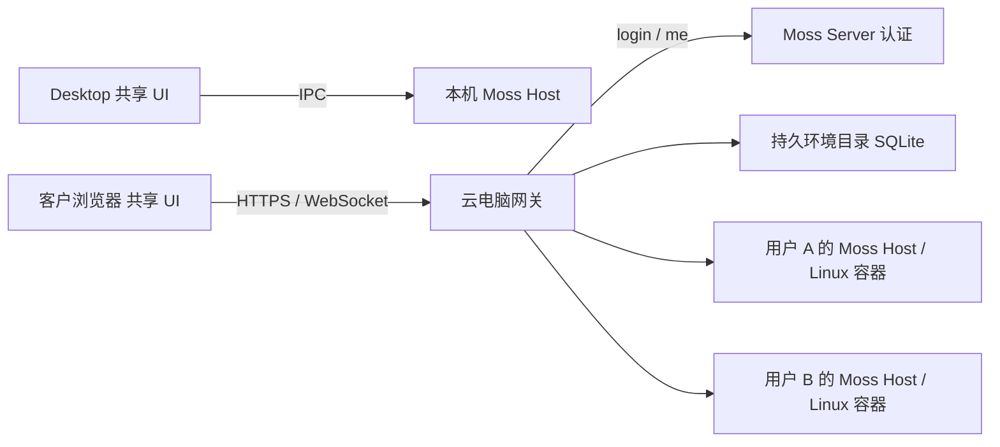

# Moss Desktop、WebUI 与个人云电脑

更新：2026-10-16。采用已确认方案：共享 Moss UI，每用户一个长期保留的 Linux Docker 容器，统一浏览器入口。系统盘恢复、Incus/VM 选型另行安排，不阻塞当前实现。执行状态与下一步见 [执行计划](webui-next-steps.md)。

## 产品模型

用户打开 Desktop，默认操作“此电脑”；打开浏览器并登录，操作“我的云电脑”。浏览器绘制界面，云端 Host 按 Moss 本地模式运行 Agent。浏览器到 Host 使用网络传输，不改变 Agent 的执行模式。

一个用户对应一个默认容器，承载其全部项目、聊天、终端、工具和配置。新建聊天只创建会话，不创建电脑。用户安装的 apt 软件、Python venv、Node CLI 和系统配置留在同一个容器中。

已有 Moss Server 远程执行连接保留。Server 当前主要提供认证，不新增远程 session 功能。用户不必在每次聊天时区分 IPC、WebSocket 或容器内“本地”。只有确实配置了其他执行环境时，才需要理解任务的实际位置。

## 组成与调用链

UI 和业务处理器共用，传输分别使用 Electron IPC 与 HTTP/WS。Host 暂时仍为完整 Electron 主进程，Linux 使用 headless 平台且不创建 BrowserWindow；不启动 Moss renderer、Xvfb 或整个桌面。镜像保留 Electron 动态链接所需系统库，它们不意味着云端绘制客户界面。未来可逐步将 Host 服务抽离 Electron，不先重写全部业务。

`cloud/gateway.mjs` 是独立 Node 网关，与用户 Host 使用同一发布镜像。网关负责账号认证、环境目录、代理、资源限制和受控程序升级。网关独占 Docker socket；用户容器没有该 socket，也不接入其他用户的桥接网络。

## 登录与环境身份

1. 浏览器提交 Server 账号密码到同源门户。
2. 网关调用现有 `/api/v1/auth/login` 和 `/api/v1/auth/me`，获取经验证的用户/组织身份。
3. SQLite 中 `(orgId, userId)` 唯一对应环境，环境级串行锁防止多个标签同时创建。控制器租约限制同一状态库只能有一个控制器执行操作。
4. 首次创建专属桥接网络、HOME 卷、受限容器；记录真实 container ID 和所有权标签。再次登录核对并复用原容器，已停止则启动。
5. Host 自己再次验证认证中心返回的身份和固定归属，签发内部 Host 会话。浏览器只获得不透明的 HttpOnly 网关 Cookie，不能选择容器地址或冒充别的环境。
6. HTTP 文件流、WS 调用和事件只代理到登录用户的 Host；网关保存内部 Cookie，不向浏览器暴露控制凭据。

网关重启后从状态库恢复映射、重新连接各私有网络，浏览器重新登录即可进入原电脑。已知容器丢失、ID 被替换或所有权标签不匹配时拒绝连接；不创建空白环境冒充恢复成功。环境目录和 installation ID 必须一起保存；丢失目录后不能自动找回原环境，应先由管理员恢复映射，避免误当作新部署。

内部管理仅通过状态卷内的 Unix socket 操作，不暴露公开创建、升级或 Docker 管理 API。`/_moss-auth` 只代理 login/me，需每环境独立控制凭据；个人容器无须加入 Server 数据库网络。写请求和 WS 校验 Origin，认证定期复核，退出撤销当前网关会话并关闭相关 WS。

## 持久化边界

| 内容 | 存放位置 | 当前行为 |
| --- | --- | --- |
| 会话、项目、工具配置、凭据、用户依赖 | `/home/moss` 独立卷 | 浏览器重连、停启、程序升级后保留 |
| apt、`/usr`、`/etc`、系统工具 | 用户容器自身写层 | 保留同一容器，不因登录或 Moss 发版重建 |
| Moss 程序 | `/opt/moss-releases/<版本镜像摘要>` | `/opt/moss` 指向当前发布目录，可切换/回退 |
| 环境归属、容器 ID、控制凭据、升级日志 | 网关独立状态卷 | 网关可更换，映射必须持续保留 |
| 任意进程内存 | 当前运行进程 | 停启与升级会中断；不承诺指令级续跑 |

当前不自动删除个人容器，不使用 `compose down` 管理个人电脑。删除/重建容器、节点损坏后的完整系统恢复属于后续工作。只备份 HOME 或只做 `docker commit` 都不等于系统层、用户卷、数据库和凭据的一致恢复。

每用户具有 root/sudo 安装能力，但 Docker 仍共享宿主机内核；它不能替代具备独立内核的 VM。客户浏览器提供 Moss UI，不提供 Linux 全桌面会话。图形自动化、内核模块、完整 systemd 等需求需另行验证。

## 程序升级与失败处理

程序升级与 Linux 系统升级分开。管理员选择已通过 CI 的固定版本镜像，`webui.sh upgrade` 在宿主机拉取或使用预载镜像，然后：

1. 检查当前/目标镜像架构、运行时兼容标签与数据 schema 标签。兼容声明变化则拒绝普通升级，避免更换程序后无法读取原数据。
2. Host 确认没有 Agent 执行、待确认请求、运行终端或正在处理的上传/RPC，进入维护状态并阻止新任务。
3. 在原容器复制新的 `/opt/moss` 内容到独立目录，记录旧程序路径与升级日志，检查 Electron 可运行。
4. 原子切换程序符号链接，重启**原 container ID**，检查健康与版本。
5. 成功后登记新版本；启动失败回切旧程序并再次重启同一容器。控制器中断后依据持久日志回退旧程序；无法回退则保留真实错误状态，不重建环境。

稳定启动脚本在 Host 启动失败时保留容器可控，允许管理员回退。复制程序用的临时 helper 容器可删除；个人电脑没有自动删除接口。旧程序目录暂保留，版本数量较多时需要监控磁盘增长。

运行时和 schema 标签是发布者的兼容契约：改变基础 OS、必要系统库、Node/启动器假设时更新 `io.moss.web.runtime`；引入不可逆数据迁移时更新 `io.moss.web.data-schema`。同一标签不允许绕过已知不兼容变更。程序回退不是数据库迁移回退。

## 断线、任务与多标签

浏览器断开只停止订阅，Host 继续工作。写调用使用 requestId、持久操作结果和请求内容校验防止重试重复执行；同会话限制并发执行轮次。重连恢复快照与可用事件，权限确认不会盲目重复提交。

Host 崩溃和网络断线不同。Host 重启后，无法确定结果的外部副作用必须如实标记中断/待核查，不自动重放。长期任务接受模型、持久 turnId 与更细的忙碌租约仍可继续优化。

首版无自动休眠。浏览器退出不会关闭容器，用户自己安装的后台服务继续运行。管理员显式 `stop` 会结束容器进程，后续登录启动原电脑；停止不是禁用账号。

## 功能一致性

| 功能 | 当前处理 |
| --- | --- |
| 聊天、Agent、本地工具、项目/会话 | 共用 UI、协议和业务服务，在该用户 Linux 内执行 |
| 上传、下载、文件预览 | 同源 HTTP 流和范围请求；浏览器文件上传到用户环境；用户 HTML 以附件/沙箱方式返回 |
| 终端 | 容器内 PTY，经 WS 传递；关闭页面不等于退出 shell |
| 托盘、桌面窗口、安装更新 | 平台能力明确区分；浏览器不伪装成 Electron 窗口 |
| App UI、特殊资源协议、原生依赖 | 继续按核心场景逐项验证，不能由共享 UI 推导为全部可用 |
| 浏览器自动化、桌面操控 | 与 Moss 界面渲染独立；需要对应 Linux 运行依赖，完整桌面能力未包含 |

保留既有 App 权限边界，不允许 App bridge 通过新传输升级成任意 Host 权限。多个用户不共用文件、Host 数据库和事件广播。退出清理浏览器页面存储，门户资源不缓存用户内容。

## 部署与容量

通过 GitHub CLI 触发 Linux AMD64 构建、浏览器验收、镜像发布与离线包。Server 安装开启 `MOSS_WEB_ENABLED=1`；新部署默认 `MOSS_WEB_DEPLOY_MODE=cloud`，旧固定用户配置保持 `single`，不自动迁移用户环境。

云门户/代理属于 Compose；用户电脑由网关管理并长期保留。门户更新不替换个人容器。独立 HOME 卷、桥接网络、CPU/内存/PID 限制和用户数上限已经实现；磁盘硬配额、容量统计、自动扩缩容和多节点尚未实现。

网关持有 Docker 管理权限，应仅由部署管理员操作并限制状态卷访问。容器共享内核，CPU/RAM 限制不构成 VM 级隔离；面向更强隔离需求时再选择 VM。容量按空闲内存、任务峰值和系统盘增长实测，不能把“用户数上限”当作硬件容量保证。

## 设计评价与后续优化

这个方案适合需要长期工作区、安装工具与后台任务的客户。一个用户一个 Host 能复用已有 Desktop 业务，避免把全部服务改成进程内多租户。比 VNC 云桌面更轻，也保留浏览器的正常文字、文件与交互体验。

主要成本在环境运维和功能适配，不能仅靠两个 transport adapter 完成。当前取舍是先做好身份归属、原容器保留、程序升级和实际验收；之后再补磁盘监控/配额、一致性备份、App 能力矩阵及故障诊断。休眠、多节点、系统恢复和纯 Node Host 逐步推进。

## Sudowork 参考

旧实现曾以 `--webui` 初始化 Electron 后端但不创建主窗口，在无 DISPLAY 的 Linux 使用 headless 平台并接入原 bridge；该路径在 2026-09-02 被移除。新版以共享 renderer、Web adapter 和 Node Web 服务代理上游 Moss Server。可参考“共享 UI + 可替换传输”，但它不自动提供每用户长期 Linux 系统。

Moss 当前复用完整 Host，在用户容器内执行本地任务；Server 暂作认证中心。这样保留用户希望安装依赖后下次继续可用的个人电脑模型。
