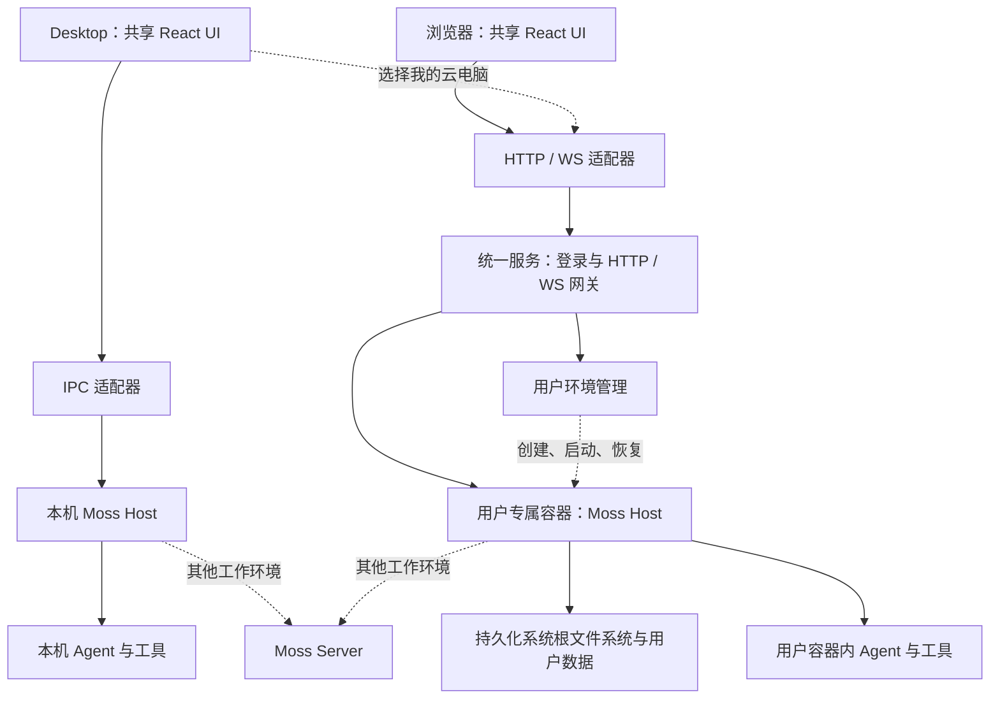

# Moss Desktop、WebUI 与持久化用户环境设计

状态：方案建议，尚未实现。基于 2026-10-16 当前 Moss 工作区、Sudowork WebUI 源码与历史记录分析。

## 1. 建议采用的产品模型

保留一套 Moss 界面、一套业务协议和共享业务服务；将“界面在哪里打开”和“任务在哪里执行”分别建模。

对客户统一使用“工作环境”这个名称：

| 客户端 | 默认环境 | 其他环境 |
| --- | --- | --- |
| Desktop | 此电脑 | 我的云电脑、管理员配置的企业环境 |
| 浏览器 | 我的云电脑 | 管理员配置的企业环境 |

浏览器只配置一个环境时不显示模式选择器，登录后直接进入“我的云电脑”。确有多个环境时，显示实际名称，例如“我的云电脑”“公司研发环境”。“local”“remote-direct”“IPC”“WebSocket”属于实现细节。

已进一步确认：浏览器所连接的用户云端 Moss Host，默认按 Moss 的“本地模式”运行 Agent，操作的是用户云电脑。浏览器通过网络连接 Host，不会让这个执行模式自动变成 remote-direct。统一服务即便复用了 Moss Server 的认证和环境管理，也不意味着每次聊天要经过现有远程 session 容器运行链路。

这保留用户要求的两种执行能力：Web 的原“本地”就是用户专属云容器内的执行；原“远程”就是连接其他 Moss Server。两者不再作为每次聊天都要理解的开关。当前已有会话的执行位置不能因为默认设置变化而静默迁移；换环境应新建会话，或者执行明确的复制/迁移流程。

产品长期对象应当是“用户环境”，而不是某个 Docker container ID，也不是一次聊天会话。

- 一个用户拥有一个默认云环境；数据结构预留一个用户拥有多个环境。
- 一个环境承载多个项目、聊天会话、Agent、App 和终端。
- 新建聊天不重新创建系统环境。
- 容器是环境的运行实例，可以停止、重新启动或在恢复时替换。
- 数据、软件环境和持久身份按照明确的恢复策略延续。
- 进程内存不属于普通数据卷持久化范围。故障后的任务恢复不能承诺从任意指令继续。

## 2. 已确认需求与设计假设

已确认：Desktop 与浏览器都能使用；UI 不单独维护一份；统一 Web 登录入口；首次创建用户环境；后续回到自己的环境；文件、配置和安装环境要延续；仍能连接 Moss Server；界面由客户浏览器渲染，不使用 VNC 传输整个桌面。

首版建议：单机 Linux 部署，每个用户一个环境，控制服务和用户环境使用独立权限；从第一天记录环境所属节点，方便以后扩展多节点，但首版不引入 Kubernetes、跨节点热迁移和自动集群调度。现有 Docker 可用于桥接和环境流程验证；正式运行后端必须满足下述系统盘持久化要求。

用户已明确要求：工具依赖和 apt 等系统软件都要保留。需要覆盖两类“安装环境”：

1. Python 虚拟环境、Node 项目依赖、CLI、App、用户目录配置：可以放入持久化目录，作为首版完整支持内容。
2. apt 安装、系统服务、对 /usr 或 /etc 的修改：仅持久化用户目录不够。正式方案需要保存整个系统文件系统，采用持久化系统容器或具有持久化系统盘的虚拟机/微虚拟机；也可以专门实现等价的 Docker 系统层保存/恢复能力，但必须验证其恢复点和升级语义。

“用户目录持久化”不能作为本需求的完整交付。系统盘、数据、备份恢复以及 Moss 升级后保留用户软件都必须进入验收。

## 3. 当前代码能复用什么

| 当前实现 | 可复用部分 | 必须调整的部分 |
| --- | --- | --- |
| [preload.mjs](../src/preload.mjs) | 集中的具名客户端方法与事件订阅 | 提取传输无关的接口映射；限定网络可调用的方法 |
| [desktop-api-types.ts](../src/renderer-react/lib/desktop-api-types.ts) | 已有请求、结果、事件类型 | 增加运行时校验、协议版本与可序列化边界 |
| [session-control-ipc.mjs](../src/session-control-ipc.mjs) | 会话停止、权限回复等业务逻辑 | 通过通用注册器接入两种传输；脱离 Electron event |
| [main.mjs](../src/main.mjs) | 本地 Agent、会话、项目、App 的实际能力 | 窗口启动、业务启动分开；事件推送不再依赖 mainWindow 存在 |
| [remote-session-runtime.mjs](../src/remote-session-runtime.mjs) | 远程连接、恢复和运行时适配 | 保留为环境后端；支持能力与文件位置正确路由 |
| [moss-home.mjs](../src/moss-home.mjs) | MOSS_HOME 与 Electron profile 隔离 | 在用户环境中固定路径并持久化，包括凭据相关密钥 |
| [runtime-manifest.mjs](../src/runtime/runtime-manifest.mjs) | 受管 Node/Python 等运行时的版本与校验机制 | 当前列出的目标仅有 macOS ARM64 与 Windows x64；需补齐 Linux 供应方式和原生依赖 |
| [session-runtime-pool.mjs](../src/session-runtime-pool.mjs) | 忙碌保护、空闲回收、容量控制 | 区分会话运行时回收和整个用户环境休眠 |
| [Server 认证](../../server/src/auth/service.ts) | 身份、组织和权限基础 | 统一入口会话、环境所有权及有效性检查 |
| [DockerBackend](../../server/src/backends/dockerBackend.ts) | Docker 启动、挂载、运行状态等基础经验 | 当前按会话/attempt 创建且使用 --rm，不是用户环境管理器 |

当前 Moss Server 的 [runtimePaths](../../server/src/runtimePaths.ts) 将 workspace/transcript 按 session 隔离，将 profile 按 user 保留；[runtimeService](../../server/src/runtimeService.ts) 在缺少运行时时创建新 attempt。因此：

| 操作 | 当前代码的含义 |
| --- | --- |
| 继续已有且运行中的会话 | 可以继续使用现有 attempt，并非每条消息都启动全新容器 |
| 同一会话运行容器重建 | 会话目录和用户 profile 可重新挂载；镜像外的容器系统修改不自动恢复 |
| 新建会话 | 默认分配新的 workspace，复用该用户的 profile |
| 软件装在 /usr、/etc 等未持久化系统位置 | 运行容器被删除后不能依靠这些挂载恢复 |
| 软件装在持久化 workspace 或 profile 中 | 文件可以保留；实际可运行还依赖解释器、路径和系统 ABI 兼容 |

Sudowork 新 WebUI 调用上游 Moss 的 create/resume 等 API，它本身不决定安装环境是否保留。不能仅根据它是“远程模式”，推断所有上线部署的容器生命周期。

## 4. 推荐架构

图中的本机 Host 和云端 Host 复用同一份业务实现。运行在云端的 Host 可以先使用 Electron 主进程的无窗口启动方式；后续逐步移除业务层对 Electron 的依赖，改成纯 Node，不作为首版前置重写任务。

Moss 页面由客户浏览器渲染，不要求在容器内运行 Moss 的 BrowserWindow 或完整 Linux 桌面。保留 Electron 主进程时，Electron 二进制仍可能依赖 Linux 动态库，具体依赖和无窗口启动参数需在目标发行版验证。字体、Chromium 或显示后端若被浏览器自动化、截图、原生 GUI 工具使用，则按这些功能准备；不应把它们一概当作 WebUI 渲染的前置条件。

Desktop 选择“我的云电脑”时，也可以使用同一套 HTTP/WS 客户端接入云端 Host；此时文件、App 和终端都归属云端环境。这个完整 Host 协议与已有 Moss Server 的远程 session 协议职责不同，不能假设现有 remote-direct 已经提供全部云电脑能力。图中虚线连接表示需要新增或保留的可选接入路径。

控制服务可作为现有 server 的新增模块：认证、环境目录、调度和网关在逻辑上分开，首版可同进程部署并复用现有账号系统和 MySQL。

云环境内的普通会话默认直接使用同一个环境中的本地运行时，不继续为每段聊天启动一套新的系统容器。跨用户隔离由用户环境提供；同一用户的会话仍保留独立工作区和权限策略。

## 5. 共享 UI 与双传输协议

建议继续放在 ui 工程中，增加薄的组合与适配模块：

| 模块 | 职责 |
| --- | --- |
| shared/client-contracts | 方法、参数、返回值、事件、错误与版本契约 |
| shared/create-moss-client | 具名客户端方法与订阅；两端共用 |
| transports/electron | preload / ipcMain 的请求与事件适配 |
| transports/web | WebSocket RPC、订阅、断线和认证接入 |
| host/request-registry | 方法注册、校验、调用上下文与权限检查 |
| host/event-router | 按环境、会话与连接分发事件 |
| host/services | 会话、项目、Agent、App、文件等共享业务服务 |
| platform | 文件选择、窗口、系统通知、资源 URL 等宿主差异 |
| 启动组合 | desktop：创建窗口；web：启动 HTTP/WS，跳过窗口启动 |

这些是建议目录职责，并不要求一次搬动所有现有文件。现有具名 API 和 channel 可以保留；迁移期间继续兼容 window.agentDesktop，避免全仓同步改名。

请求注册应拥有同一份业务处理器，IPC 和 WS 都调用它。不能把浏览器输入直接当成任意 ipcMain channel，也不能伪造 Electron sender 来绕过原有来源检查。将这些检查转成明确的调用上下文：身份、环境、连接、权限以及可选的桌面窗口身份；身份由宿主验证产生。

常规请求与事件可以使用 WebSocket；页面资源、上传下载、图片和大文件走 HTTP 流。事件按环境与会话过滤，不能把所有用户的事件广播给所有连接。

Web 登录只完成一次。网关验证 Cookie 和连接来源，再把经过验证、仅属于目标环境的身份上下文传给 Host。用户容器不掌握控制服务的签名主密钥，也不持有 Docker 管理权限。

## 6. 任务、断线与多客户端

目前 send 的 Promise 可以等到整轮结束。网络模式应逐步提供“持久接受请求 → 返回 turnId → 事件更新状态”的接口，保留旧 send 的兼容等待封装。不能仅靠一个长期挂起的 RPC Promise 表示任务存在。

- 使用 requestId/idempotencyKey 防止断线重试重复创建会话、重复执行命令或重复回答确认。
- 接受写请求后先持久化任务标识，再返回接受结果；重试查回同一结果。
- 事件具有序号；重连优先恢复快照，再补齐可用增量。不能只恢复最后一段聊天文本。
- 浏览器断开时取消订阅，不等价于 abort。
- 停止任务是明确操作，由 Host 处理。远程上游连接由 Host 持有，浏览器断线不直接关闭它。
- 同一会话每次只允许一个有效的执行轮次；多个页面可以查看，提交和权限回复在后端做并发控制。
- 已处理的权限请求不能再次批准；拒绝旧 generation 的操作。
- Host 故障与浏览器断线不同。Host 重启后将未能确认结果的外部副作用标记为待核对/中断，不能自动重放以假装“精确一次”。

完整状态包括会话、任务、待确认、工作区和环境状态。聊天内容只是其中一部分。

## 7. 用户环境与首次创建

建议环境记录包含：environmentId、orgId、userId、displayName、kind、runtimeKind、desiredState、observedState、nodeId、instanceId、generation、baseImageDigest、environmentRevision、systemVolumeRef、dataVolumeRef、hostRelease、protocolVersion、lastActiveAt、busyLeases、lastBackupAt 与 lastError。instanceId 对应实际容器或虚拟机实例，独立于长期 environmentId。

初版默认环境以 orgId + userId 唯一关联。创建使用数据库唯一约束、操作幂等键和环境级锁，避免用户在两个浏览器同时登录时得到两个容器。

首次流程：登录 → 查询默认环境 → 原子登记 creating → 从基础模板建立持久化系统盘并分配用户数据存储 → 初始化目录/权限 → 创建运行实例 → 等待 Host 就绪与协议握手 → 标记 ready → 接入用户界面。

再次登录：ready 时连接；stopped 时启动原实例；运行实例丢失时根据系统盘、用户数据和环境版本恢复；故障时显示真实状态及可重试入口。创建失败不得删除已存在的用户数据。控制服务重启后应与所选运行后端的实际状态核对，不能只相信缓存中的 instanceId。

容器只在内网开放 Host 端口，统一网关按已认证的用户和环境目录路由。浏览器不提交 Docker socket、节点地址或任意容器 IP。对于其他 Moss Server，使用已登记的目标环境，避免将用户输入变成任意网络代理。

## 8. 持久化：文件、软件与系统分别承诺

建议稳定的容器内路径如下：

| 路径 | 内容 | 生命周期 |
| --- | --- | --- |
| /home/moss/.moss | 会话、配置、Memory、App 状态、Host 数据库 | 用户环境持久保存 |
| /home/moss/workspaces | 项目、文档、工作区和项目虚拟环境 | 用户环境持久保存 |
| /home/moss/.local、受管 runtimes 目录 | 用户 CLI、解释器、工具安装 | 持久保存，记录版本与架构 |
| profile/browser-data | 浏览器 profile、已授权登录等 | 如启用对应能力则持久保存并备份 |
| cache、tmp、日志 | 下载缓存、临时文件与运行日志 | 明确区分可清理与需保留内容 |
| 持久化系统盘/根文件系统 | OS 包、/usr、/etc、系统工具链及配置 | 必须持久保存，具有独立备份和版本信息 |
| Moss 程序发布目录 | Moss Host 程序与发布资源 | 可共享、只读、按版本更新；与用户系统盘分开升级 |

备份必须包括解密用户凭据所需的密钥材料，并与数据采用一致的权限和恢复流程。单独复制加密数据库而丢失密钥不能称为可恢复备份。

普通容器停止再启动时，其写层通常还在；但容器删除、替换、跨机器恢复时，不能依赖旧写层继续存在。应明确区分：

1. 重连浏览器：环境不变。
2. 停止/启动同一容器：原写层保留，进程重新启动。
3. 重建/升级运行实例：只保证已持久化的数据和可恢复的软件环境。
4. 节点或存储故障：由备份/存储副本和恢复点决定可恢复范围。

系统软件持久化的运行后端选择：

| 方式 | 日常重连/停止启动 | 替换、升级与恢复 | 建议用途 |
| --- | --- | --- | --- |
| 长期保留同一个 Docker 应用容器 | 原写层仍在，apt 等修改可以保留 | 删除/重建时必须另外恢复系统层；只挂 HOME 不够 | 快速验证；须明确容器与系统层备份策略 |
| 持久化系统容器，例如 Incus/LXC | 系统根文件系统作为环境存储保留 | 通过受支持的存储、快照、备份机制保存和恢复 | 优先评估，符合用户希望“一人一容器”的目标 |
| 虚拟机/微虚拟机 + 持久化系统盘 | 系统盘长期保存 | 通过磁盘快照和恢复维护整机状态 | 需要更强内核隔离或容器无法满足的软件能力时使用 |

系统容器仍共享宿主机内核，不能承诺任意内核模块/系统级能力都和独立 VM 一样。现有主机是否支持相应运行后端、存储驱动和隔离要求，需要在部署选型验证中确认。

如果继续选择普通 Docker，不能仅取消 --rm 就宣布满足所有恢复场景。需要定义并实现系统检查点、私有镜像/层的备份、数据卷一致性和节点恢复；检查点只承诺最近成功保存的系统状态。这通常比单纯挂载用户卷多一项环境运维成本。

重要优化：Moss 程序升级与用户 Linux 系统升级分开。Moss Host 使用独立版本目录或程序卷更新，不因发布 Moss 新版本而重置用户系统盘。用户 apt 安装和系统配置继续保留。Linux 系统升级则单独执行、备份和验证。

Python venv 和编译后的 Node 模块即使文件仍在，也可能不兼容新的基础镜像。环境升级必须固定/检查 OS、解释器版本和 CPU 架构，验证成功后切换；不能每次启动自动套用 latest 镜像。

## 9. 文件、App 与功能一致性

用户所说的“像本地电脑一样”，建议验收为：同一套 Moss 操作流程、长期个人环境、功能可发现、状态可恢复。Linux 与 macOS/Windows 的原生软件和系统 API 不能直接当作完全相同。

| 能力 | 共用内容 | Web/云端需要适配 |
| --- | --- | --- |
| 聊天、项目、会话管理、Memory | UI、协议和业务服务 | 网络传输、状态恢复 |
| Agent、Skills、CLI/MCP | 运行逻辑和配置语义 | Linux 包、持久依赖、进程管理 |
| 文件树与预览 | 文件模型、查看器、编辑界面 | HTTP 内容接口、范围请求、资源身份 |
| 文件选择和拖入 | 同一附件流程 | 浏览器上传后得到环境内引用；不能依赖客户电脑绝对路径 |
| 终端 | PTY 服务与终端组件 | WS 数据通道、resize 和恢复策略；cwd 必须属于该会话的真实环境 |
| App | 协议、权限、安装状态和大部分业务 | App UI 容器、资源协议、Linux 原生依赖逐个验证 |
| 浏览器自动化 | 工具协议和任务流程 | 如需 Chromium，在用户环境内按需启动；它与 Moss UI 渲染是两件事 |
| 原生桌面操控 | Host 权限与控制流程 | 依赖 Linux 控制驱动；必要显示后端由该能力引入 |
| 托盘、应用安装更新、窗口按钮 | 平台能力契约 | 浏览器提供对应体验或明确不适用 |

统一资源引用应携带 environmentId、workspaceId、相对路径或受控资源 ID。网络请求不直接信任客户提交的服务器绝对路径。已有 App SDK 权限体系继续保留，不能因增加通用 UI bridge 而把 App 调用升级成任意 Host 权限。

文件预览与 App HTML 可能执行代码，必须使用隔离的资源来源/沙箱。不能将用户生成的 HTML 与登录门户放在拥有同等凭据权限的来源中。

“一套 UI”允许平台适配，不意味着通过大面积隐藏功能就完成一致性。完整首版需要公开列出能力矩阵及未完成项，并逐项验收。

## 10. 登录、隔离与配置归属

控制服务保存账号/环境归属、运行位置、配额、调度状态和备份元数据；用户 Host 保存实际业务配置、工作区和会话；外部 Moss Server 保存其执行任务对应的远端数据。禁止将同一份业务数据同时设为两个系统的可写真相来源。

门户可以复用现有 Moss 身份服务，不要求用户拥有第二套密码。外部 Moss Server 凭据属于具体用户/环境连接配置，不能把门户登录与任意远端账号视为自动等价。

- 同一用户多标签页可共享同一个环境，不同用户不能共享 Host profile、文件卷或凭据。
- 网关依据认证结果检查环境所有权；环境 ID 可见不代表可访问。
- 用户容器不挂宿主机 Docker socket，不持有控制服务或其他用户密钥。
- 配额至少覆盖 CPU、内存、进程数、磁盘和并发任务；环境创建排队与失败状态必须可见。
- 账号停用/退出需要处理现有 WS 会话，不能只禁止下一次 HTTP 登录。
- 浏览器缓存按身份/环境分区，退出后清理相关会话缓存，防止同一浏览器换账号看到上一用户状态。

## 11. 休眠、定时任务与长连接

“长期保留”与“所有用户永久占用 CPU/RAM”分别处理。用户数据长期保留；运行实例可以按策略休眠。

首版默认不因浏览器断开就停止环境。启用自动休眠前，Host 必须报告忙碌租约，覆盖 Agent 执行、权限等待、App 后台任务、终端作业、MCP 长期服务及外部消息订阅。用户自行安装的后台系统服务不一定能被 Moss 正确识别，因此有未知常驻服务的环境应保守保持运行；自动休眠作为后续明确的环境策略。

纯定时任务需要控制服务能够在 nextRunAt 前唤醒环境。首版可选择对有定时任务/长期监听的环境保持运行；不能在只存在容器内计时器时直接停止容器，然后承诺任务照常触发。

后续中央调度只保存唤醒所需元数据和执行幂等标识，任务业务定义仍由拥有者管理。使用调度租约和触发去重，处理服务重启与重复唤醒。

## 12. 升级、恢复和版本兼容

- 运行环境记录基础模板 digest、系统盘修订、数据 schema、Host 发布与协议版本；用户安装软件后，不能再仅用基础镜像 digest 表示完整环境。
- 统一 UI 使用带版本的静态资源；与 Host 进行兼容性握手。首版可按同一发布版本部署 UI/Host，已有 Desktop 版本仍须明确兼容范围。
- 升级先等待业务空闲并阻止新写入，创建一致性备份/检查点，再迁移和启动新实例；业务健康检查通过后切换路由。
- 有破坏性 schema 迁移时，回滚需要对应数据备份，不能只换回旧镜像。
- userData、SQLite、凭据和工作区备份必须考虑一致性，使用受支持的数据库备份或暂停写入方式。
- 新旧 Host 不得同时写同一个环境卷。恢复与迁移使用环境锁及 generation 防止旧进程继续写入。
- 多节点扩展时记录卷所属节点；没有共享/可迁移存储时不能假设换个节点即可启动。

## 13. 推荐实施顺序

| 阶段 | 交付 | 验收重点 |
| --- | --- | --- |
| 0：统一桥接 | 方法契约、处理器注册、事件分发；Desktop 继续工作 | 桌面核心流程不变，已有来源检查转换完整 |
| 1：单用户双端闭环 | Web 启动、Linux Host、聊天/文件/终端、另一 Moss Server 连接 | 两端通过同一协议；断线不重复执行；两种执行位置正确 |
| 2：用户环境平台 | 登录、首次创建、持久卷、再次启动、用户隔离、配额 | 双标签首次登录只建一个环境，用户之间无数据串用 |
| 3：环境与功能连续性 | 工具与系统软件持久化、App/预览/浏览器能力、备份升级 | 系统盘恢复及 Moss 升级后软件仍可用；完整核心功能矩阵通过 |
| 4：运营优化 | 空闲休眠、定时唤醒、镜像缓存、多节点接口、容量与观测 | 成本与延迟有实测依据，后台任务语义保持正确 |

阶段 1 是技术验证，不等于用户要求的完整产品交付。完整首版至少覆盖阶段 0–3；系统软件持久化已是确认需求，不能作为可有可无的后续优化。

实施不要先全仓搬文件，再开始验证浏览器。先完成一条真实路径：登录/接入 → 新建会话 → 执行工具 → 权限确认 → 文件预览 → 断线重连。随后沿相同协议迁移其他功能。

## 14. 验收场景

1. 同一 UI 在 Desktop 与浏览器打开；请求、错误和状态语义一致。
2. 用户 A 首次登录创建默认环境，刷新/双标签不会重复创建；用户 B 得到独立环境。
3. 安装 Python 依赖、Node/CLI 工具、App，重连、新会话、容器停止/启动、按约定重建后分别验证可用性。
4. 对 apt 安装与 /etc 修改执行重连、停止/启动、Moss 程序升级和备份恢复测试，验证实际恢复点。
5. 同一用户创建多个聊天，环境不变、工作区按设计隔离；环境内资源共享行为可解释。
6. 任务运行时关闭浏览器，再次进入能看到真实结果；多次重连没有重复副作用。
7. Host 在命令执行中崩溃，恢复后如实报告中断/待核对，不能假报成功或盲目重试。
8. 客户端文件上传后由选定环境处理；远端会话的文件、终端和下载都来自正确环境。
9. 多页面同时发送、停止或回复确认，不产生双重执行；旧确认不能跨环境重放。
10. App HTML 与预览不能获得门户账号或其他环境访问权限。
11. 有后台服务/定时任务的环境不被错误休眠；唤醒任务不会漏发或重复。
12. 备份恢复到替代运行实例后，会话、配置、凭据、软件和文件符合承诺。
13. 旧版 UI/Host 不兼容时提供升级或刷新路径，不出现静默错误。

## 15. 设计评价与优化取舍

这个方向适合需要持续工作区、安装工具、长期 App 和自动任务的用户。一人一环境也让已有单用户 Desktop Host 更容易复用，减少一开始将所有状态改造成进程内多租户的工作。

主要代价不是 UI 复制，而是个人环境运维：Linux 功能适配、软件恢复、后台任务与休眠、隔离、升级和容量。仅靠两个 transport adapter 不能完成这些产品保证。

建议保留：共享 UI、统一协议、用户级环境、统一登录、可连接其他执行环境。

建议简化：Web 默认只显示一个“我的云电脑”；不再向用户解释容器内“本地”和远端“远程”；首版复用现有认证/数据库；先单机部署；先复用 Electron 无窗口 Host；预留 Node Host 的边界而不先重写全部服务。

建议尽早完成：环境与 session 分离；验证持久化系统根文件系统；任务与浏览器连接解耦；平台能力清单；备份恢复验证。

建议暂缓：每个聊天一个个人电脑容器、默认启动整个图形桌面、全量双向同步本机与云端所有文件、跨节点热迁移、自动集群调度。确有图形自动化需求时，为那项能力按需准备图形/浏览器进程。

成本优化以测量为依据：记录每个就绪 Host 的空闲内存、活跃任务峰值、启动时长、磁盘增长与并发需求。使用共享基础镜像、用户独立数据、缓存和空闲策略；不能用未经压测的“每个容器固定消耗多少”承诺容量。

## 16. Sudowork 参考的适用范围

- 旧版提交 85eba8ab 的父版本：--webui 初始化 Electron 后端并启动 WebServer，不创建主窗口；无 DISPLAY 的 Linux 设置 ozone-platform=headless；WebSocket 接入原 bridge。该模式在 2026-09-02 被移除。
- 当前 [共享界面入口](/Users/bgd/repo/sudowork/apps/webui/src/client/shared-renderer/main.ts)：安装 Web adapter，再挂载与 Desktop 相同的 renderer。
- 当前 [Web adapter](/Users/bgd/repo/sudowork/apps/webui/src/client/bridgeAdapter/mossAdapter.ts)：将 bridge channel 映射为同源 HTTP/WS；桌面能力按宿主处理。
- 当前 [Node Web 服务](/Users/bgd/repo/sudowork/apps/webui/src/server/index.ts)：处理会话与代理，上游执行属于 Moss Server。
- 当前 [Dockerfile](/Users/bgd/repo/sudowork/apps/webui/Dockerfile)：跳过 Electron 下载，运行 Node。

采用“共享界面 + 可替换传输”的思想，并保留 Moss 完整 Host 的复用路径；持久化个人环境需要在服务端单独实现，不能从 WebUI 的传输方式自动获得。
