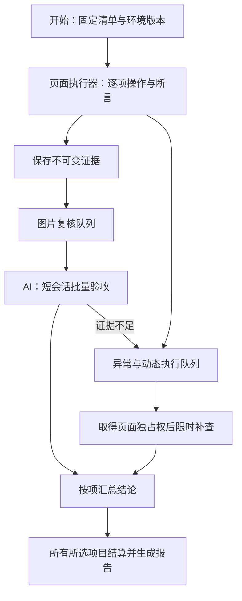

# AI 自测执行优化方案

2026-10-14 · 执行与验收并行、正常结束协议、环境变更检测和分阶段进度已实施；阶段实测已完成，最终安装版正在验证。

目标：在同一环境、同一清单、同一模型配置和同等验收要求下，自动自测的总耗时接近直接批量测试。保留 AI 的视觉、语义判断和异常发现能力。以完整验收时间衡量收益，不能通过减少用例或未完成复核实现提速。

证据基础：[执行设计审查](../../output/self-test-design-audit-20261014/review.md)、[耗时数据](../../output/self-test-design-audit-20261014/measurements.json)。用户最新 0.1.4 运行中，准备后约 504 秒里，工具执行的合并墙钟时间约 60 秒；其余包含模型、服务和调度等待。历史 0.1.8 的 27 项专项中，图片复核约 152 秒，动态执行和诊断约 1,900 秒。两类问题分别需要减少模型往返、控制诊断对整轮的影响。

## 1. 验收目标先固定

建立与直接批量测试方式对应的参考执行器，使用与自测相同的页面用例、证据要求、模型与并发上限，记录双方具体的批次策略和配置。它从外部直接调用执行和验收模块，不经过 App 面板及完整调度器。参考执行器应保留独立入口和测量边界，不能直接调用被比较的整个 scheduler 来形成循环验证。

| 指标 | 初始验收门槛 |
| --- | --- |
| 默认 31 项总时间 | 同条件三组配对运行的中位数，`T_self / T_reference ≤ 1.2` |
| 总时间范围 | 点击开始至最终所选项目结论与报告落盘，包含环境准备、排队、复核、补查及收尾 |
| 覆盖 | 原 31 项及其必要检查、截图验收全部保留；脚本通过但 AI 未验收不算完成通过 |
| 额外模型轮数 | 相同证据下不增加常规复核轮数；额外调用必须能归因到修复格式、证据不足或诊断 |
| 上下文 | 常规复核不携带其他批次历史；每批字数、图片数量、实际 token 可追溯 |
| 异常隔离 | 单项定位异常不会让独立的后续页面检查等待该项 AI 深查 |
| 停止 | 2 秒内停止派发新工作；在途执行、保存与清理分别报告实际状态 |

1.2 倍是用户要求转化的设计门槛，尚无达标实测。默认 31 项以 3–5 分钟作为容量规划假设；绝对时间最终随同条件参考基线确定，不能将其宣传为已达到的速度。出现真实慢响应或产品缺陷的运行，仍完整计时并说明原因，不删除异常样本。

参考双方都预先具备测试脚本；编写、维护脚本的人工/代理工作量另记。若比较不同模型的交互式代理，结果只能作为体验参考，不能用于归因调度性能。31 项与 59 项分别报告，复杂工作流和外部能力继续计入所选全量清单的总时间。

## 2. 总体结构：一个页面执行器，一个图片复核器

当前实际清单为 59 项，其中 51 项有脚本、8 项动态执行；默认 31 项全部有脚本，默认需要目标模型的项目是 `session-switch`、`chat-response`。现有文档的“10 项动态”与代码不符，后续改为构建时从清单自动生成数量。



页面执行器保存当前用例的证据后继续下一项，不 await 该项 AI 复核。图片复核只看已封存的截图与事实，不操作目标窗口，因此可与下一项页面操作重叠。同一时刻最多一个操作者拥有页面。

第一版保持一个控制会话：正常阶段只负责图片复核；页面阶段结束后，该控制槽位再用于动态执行或诊断。复用现有独立 recipe worker 和 `evidenceReview` 能力，不立即增加多个 AI、多个 Electron 或全局多会话调度。

被选中的动态用例仍属于本轮，不能作为可忽略的后台任务。执行顺序默认将独立的固定用例放在前面；存在声明依赖或不允许重排的用例保持其约束。最终完成条件始终包含所选动态项与规定的补查处理。

## 3. 调度规则

### 页面执行

每项建立明确的 `setup → actions/assertions → capture → cleanup` 生命周期。关联会话、项目、文件使用本轮及本项标识，保存后续可重新定位的 fixture 引用。预置测试数据与通过 UI 验证产品行为保持明确边界，不能通过内部 IPC 或写存储替代被测操作。

常规控件查找默认上限 3–5 秒。超时立即保存局部结构、相关截图和失败步骤，最多重新观察并定位一次。等待真实模型或任务时使用产品状态条件及该类用例的剩余预算；不能把等待任务完成的数分钟时限套在普通按钮定位上。

一个动作批次完成连续的已知点击、输入、等待与断言，避免每个点击返回模型。脚本源代码与完整 DOM 留在证据目录，不回灌复核提示。

只有 cleanup 确认窗口恢复到可操作状态，下一项才能取得页面。恢复失败时将受影响项目记录为环境阻塞；不能为了吞吐量继续污染后续测试。

### 图片复核

每批最多三项，首批证据就绪后等待凑批的时间不超过 500 毫秒。根据图片数量和大小提前拆批，而不是为了凑满三项延迟首个结果。

建议首版每批文本约 4,000 token 以内、图片不超过 10 张、总字节不超过 8 MiB，作为待基线校准的工作限制。完整证据始终保留；超过限制的单项按检查点拆成多个复核任务，前后对照图片放在同一任务，全部必要任务完成才允许整项通过。不能静默截断图片或必需观察。

队列初始最多容纳六个用例，预计工作量也受最早单项截止时间约束。队列满时页面执行器暂停取新用例；用有限背压避免图片、内存和到期任务持续积压。复核优先处理最早截止的任务。

同一模型服务还可能承担目标聊天。第一版不主动叠加控制端和目标端的模型请求：对声明需要目标模型的执行阶段，等待正在进行的复核批次结束，暂缓新复核；目标模型步骤完成后恢复。服务容量足够时再依据实测放开，并分别记录限流与延迟。

### 动态执行与诊断

截图已能确认的视觉缺陷直接记问题，不必重做操作。定位器冲突、文件证据缺失等明确的测试设施问题直接进入对应分类，不先消耗一整轮图片复核再决定补查。

需要真实页面的补查排队，取得独占权后执行。短会话只含该项目标、失败步骤、事实、图片及 fixture 引用；一次局部观察后批量执行已确定的动作。一次重新定位仍不成功就结束本次补查，保留证据不足状态。

第一版在保留的目标实例中按 fixture 引用重建页面前置条件；不能把之后页面的状态冒充失败时现场。无法重建时明确“未完成复现”。需要完整环境快照的用例留待后续增加独立诊断实例，不能偷偷重置全部目标数据并删除已完成用例的产物。

AI 探索能力保留为深度测试中的有界任务：给定模块、风险与时间预算，由 AI 观察后设计并批量执行操作，输出可复现问题及新增用例候选。已选择的动态场景继续执行；额外探索不混入默认 31 项的性能比较。

## 4. 总时限与补查时限

运行使用单调时钟维护截止时间；落盘另外记录真实日期时间。同一个 attempt 中的等待、模型调用、重试、排队和清理共享截止时间，所有 attempt 还受整轮截止时间限制。额外诊断是事先预算明确、单独记账的一次追加尝试，不隐式延长原 attempt。

| 类别 | 初始执行与验收总预算 | 补查规则 |
| --- | ---: | --- |
| 常规固定 UI 用例 | 90 秒/项，从首次执行到必要复核，含队列等待 | 默认最多一次，60 秒 |
| 目标真实模型用例 | 保留现有用例预算，基线采样后再调整 | 默认最多一次，60 秒；不重复发送成功消息 |
| 常规图片复核 | 每批最多 45 秒且不超过最早用例的剩余预算 | 格式修复最多一次，仍使用剩余预算 |
| 所选动态场景 | 使用清单显式预算；内部定位仍为 3–5 秒 | AI 执行与补查共享该场景预算 |
| 默认清单的额外诊断 | 本轮诊断阶段最多 120 秒，从该阶段启动计时，包含阶段内排队 | 同时受整轮截止时间限制；超出则记录未完成 |

常规验收预算到期后先结算为 `inconclusive`，不能继续显示原 attempt 运行中。若有诊断价值，在本轮剩余诊断预算内安排一次独立的诊断 attempt；原 attempt 的超时记录保留，新 attempt 不能覆盖原计时。每项最多一次补查，补查从实际派发起最多 60 秒，并截断到诊断阶段和整轮剩余时间。等待诊断阶段的用例显示“验收未完成，待补查”，等待也计入该用例累计墙钟和整轮总时间，不伪装成已通过。

运行级截止时间同时约束以上预算；取消优先级最高。诊断队列不能在 120 秒阶段结束后继续自动加时，之后的人工发起复测是新的关联运行。截图复核超时后其他 UI 检查仍可继续，但依赖其结论的项目不得假定通过。模型服务持续失败时停止继续发送复核请求，把剩余项标为验收不可用，报告已经完成的页面事实。

到期/停止后只停止本轮派发与控制。用例拥有的目标任务通过其取消操作在独立的短清理预算内停止；若目标任务仍在运行，报告保留这一事实，不能宣称全部已停。预期取消与模型/网络错误分别记录。

## 5. 结果协议：程序保管事实，AI 提交判断

每项事实证据先原子落盘，然后进入复核队列。图片使用 `evidenceId`、哈希、页面/窗口标识、捕获时间与 `checkIds` 关联。AI 不生成本地绝对路径，不重写程序已经保存的断言。

建议拆开运行状态与最终判定：

```ts
type CaseResult = {
  caseId: string;
  attempts: Array<{
    attemptId: string;
    phase: 'queued' | 'executing' | 'awaitingReview' | 'reviewing' | 'diagnosing' | 'settled';
    execution: 'notRun' | 'ok' | 'assertionFailed' | 'harnessError' | 'blocked' | 'canceled';
    review: 'notRun' | 'accepted' | 'defect' | 'insufficient' | 'error' | 'canceled';
    evidenceBundleId?: string;
    reasonCode?: string;
  }>;
  verdict: 'pending' | 'passed' | 'failed' | 'blocked' | 'inconclusive' | 'canceled';
};
```

模型提交绑定到 `reviewJobId`，逐检查点返回 `ok / defect / insufficient`、关联证据 ID 和简短依据。Host 从可信会话绑定派生 run、用例及证据范围；Backend 严格校验并持久化后返回回执。只生成“已提交”的文字不视为完成。一次格式补交只能使用已有证据，不能再次操作页面。

通过条件为所有必需程序断言成立、必要视觉/语义检查被接受、证据完整，且无未处理的产品缺陷。模型复核中断属于验收未完成；缺少前置能力属于阻塞；明确产品行为不符属于失败。真实失败重试成功仍保留偶发失败记录；纠正测试错误必须保留原错误、具体纠错依据及补齐的证据。

截图契约逐项声明要呈现的区域和状态：主题前后整块外观、保存后的字段和值、原窗口与预览窗口等。截图前验证目标区域与相关控件可见，保存窗口尺寸、区域边界和状态标记；文件存在、非空或尺寸足够不能单独证明语义覆盖。漏拍时仅在现场仍有效且操作幂等时允许程序补拍一次。

## 6. 并行后必须改变的状态管理

现有 `current.activeCaseId` 同时表示执行项与复核项，`onCaseRecorded` 是全局回调，`record` 以全局 `current.sessionId` 和 `activeCaseIds` 判断结果归属。直接删除 `await review()` 会引入错项、过期提交与清理竞态，不能作为实现方式。

新增 run coordinator，保存独立的执行任务、复核任务和诊断任务。每个控制会话绑定不可变的 `{runId, jobId, attemptId, caseIds, evidenceBundleIds, generation}`，提交只影响其绑定项。UI 的当前执行项与当前复核项从任务状态分别派生，旧 sessionId 仅可作为显示兼容字段。

所有状态变更通过同一个 reducer 和串行持久化队列处理。重复提交按 job/attempt 幂等返回原回执；停止、换版本或新一轮启动后，旧 generation 的迟到结果不能覆盖当前数据。复核部分提交可以逐项保存，但整批任务只有在所有绑定检查结算后才关闭。

正常完成通过结构化结果收齐事件收尾；用户取消和到期才走 abort。完整移除用“提交后等一秒再伪装用户中断”驱动正常完成的方式，需在会话运行层做对应的受控结束适配与验证。报告保留正常完成、取消、失败三种原因。

## 7. 环境与构建必须可追溯

开始时记录实际 Host 构建摘要、自测 App 版本与包哈希、脚本/清单摘要、目标安装清单、相关设置及资源的指纹、模型配置摘要。开发目录有未提交修改时，不能仅靠 Git commit 标识构建。凭据只使用宿主内部配置修订号比较，不输出值或可被离线猜测的明文摘要。

清理业务数据、同步环境和复用工具链分别处理。默认跟随当前主环境：比较指纹，只有变化部分重新准备；运行期间使用已捕获的快照，下一轮才采纳新变化。工具链与不可变包可复用，业务目录、设置与凭据维持目标隔离。

若用户显式选择冻结环境，面板显示其版本与准备时间。构建产物与运行安装不一致时清楚提示，并提供现有安装流程；测试启动不能静默替用户安装另一个 App 版本。

新协议采用明确的能力版本，Core 先提供兼容能力，再发布声明最低 Host API 的新 App。单独升级 App 不能假定正在运行的 Host 已具备新行为。最终安装链路验证包括实际进程加载的包哈希与目标环境指纹。

## 8. 用户看到的进度

面板同时显示两种进度，例如“页面检查 24/31 · AI 验收 18/31 · 待补查 2”。逐项展示执行中、待验收、验收中、补查中、已结算及实际耗时。通过数量与已结算数量分别显示。

主计时器从点击开始持续到整轮结算；阶段详情列环境准备、页面操作、目标模型等待、复核排队、模型复核与诊断。并发阶段的占用时长不能直接相加当成总墙钟时间。被主动停止、超时或证据不足的项始终可见，不被折算成通过率里的已测成功项。

常规检查与必要复核结束可以显示阶段结果；只要所选动态项目或本轮补查仍在进行，整轮就保持运行状态。测试结束保留目标实例、业务产物、截图和完整报告。

## 9. 代码落点与交付顺序

| 阶段 | 主要修改 | 阶段完成条件 |
| --- | --- | --- |
| A：统一度量与环境 | Core `app-testing/reusable-instance.mjs`、`profile.mjs`、`host.mjs`；App 报告与验证脚本 | 构建/环境指纹可核对；完整计时和同条件参考入口可运行 |
| B：并行执行与复核 | App `service.mjs` 拆出 coordinator、review queue、result reducer；复用 recipe runner 与 worker | 一个页面执行器与一个复核会话重叠工作；没有错项/迟到结果覆盖；单项异常不阻塞独立项 |
| C：证据与预算 | App recipes、review-prompt、提交 schema；Core review evidence 与会话完成接口 | 证据 ID 绑定、单项/整轮预算、短格式修复、正常完成适配；关键截图满足契约 |
| D：完整验收 | 默认 31 项、所选 59 项、UI 报告、实际安装链路与故障验证 | 满足同口径 1.2 倍门槛且覆盖不退化；未达标按阶段数据继续优化 |

以上 App 路径位于相邻 `moss-apps/apps/self-test/`，Core 位于本仓库。测试内容、调度、判定与报告继续归 App；Core 只负责环境、进程、受限控制会话及可信来源。Host 合同从 `packages/host-contracts/src/testing.mjs` 生成类型与校验器，不手工改生成文件。

A–C 在隔离开发环境分段验证，D 使用同一个最终不可变构建做完整验证，通过后再走安装交付。避免每个小修都生成一个无法说明整轮改善程度的发布结论。

## 10. 验证设计

1. 调度与协议：暂停复核器时页面执行能按队列容量继续；队列满后正确暂停；结果乱序、重复、迟到、部分提交都落在原用例；停止后不再派发。
2. 单项恢复：定位异常保存证据并结束；cleanup 恢复成功后后续独立项继续；恢复失败明确阻塞受影响项。模型格式错误只补交一次，队列等待和重试不重置时限。
3. 证据质量：复用现有 1848×46 标题截图作为“不足”样本；加入遮挡、白屏、错会话、错误持久化状态及重复按钮等可控缺陷，确认仍能发现问题。不能只验证通过路径。
4. 性能：在用户完整安装环境、同一清单、同一模型/参数下，A/B 交错做至少三组完整配对运行。分别记录冷准备与已缓存环境；禁止两个被比较的运行同时竞争资源。记录所有失败和慢样本，不拼接专项结果。
5. 模型成本：从实际请求/响应记录调用次数、输入及缓存 token、图片大小、首响应/完成时间；不能只比较 prompt 字符。目标端真实模型与控制端复核分开计量。
6. 发布：最终包安装后再次核实实际版本和包哈希；开始、停止、重开面板、报告落盘、目标保留、主环境升级后的同步都从真实入口验证。

参考与自测共享脚本只能控制执行口径，不能独立证明脚本正确。因此第 3 项的已知缺陷与证据核对必须独立进行。只有速度门槛和正确性门槛同时满足，才能认定这次优化完成。
